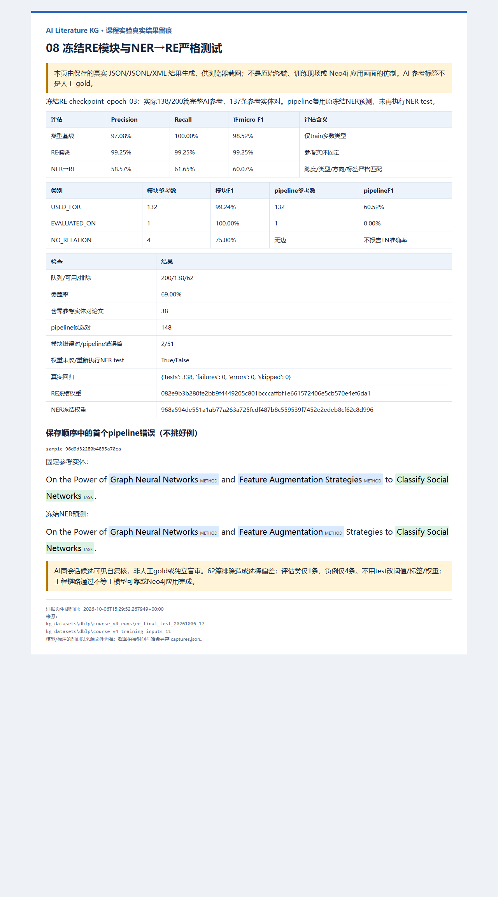
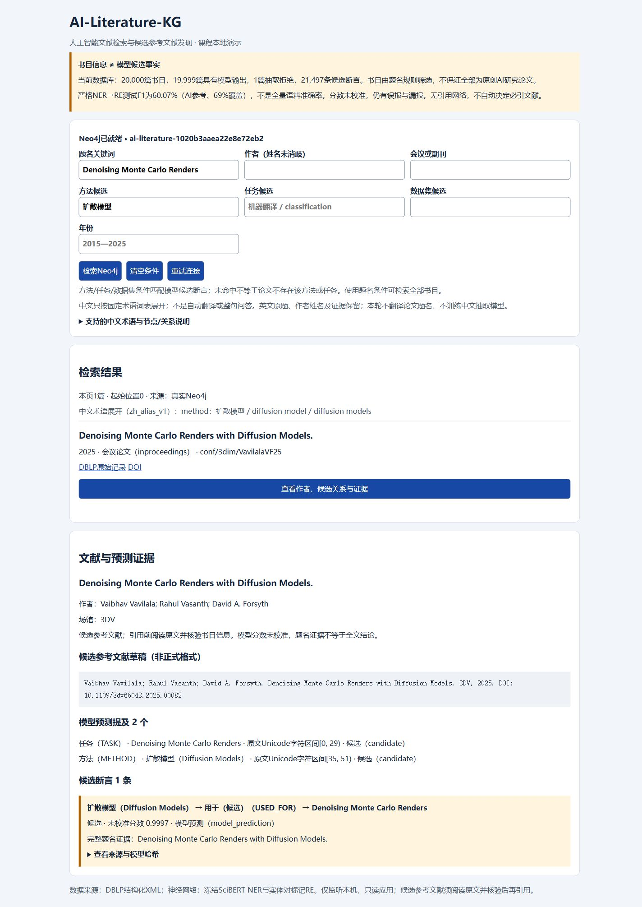
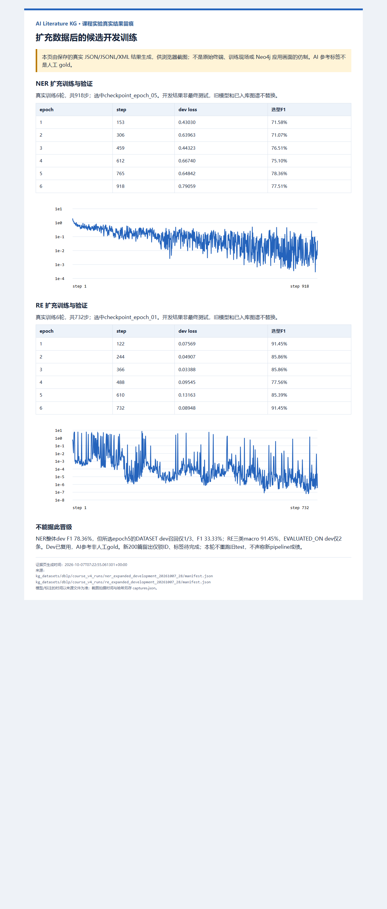

# 人工智能文献知识图谱构建与候选文献检索实验报告

## 一 总体目标与实验结论

本项目选择人工智能文献领域，构建连接作者、论文、会议或期刊，以及论文题名中方法、任务和命名数据集的知识图谱。应用目标是帮助使用者发现候选文献、查看作者合作与研究线索，并回溯每条模型候选关系的原始题名证据。系统不自动判定某篇论文必需引用，也不把题名预测当作已经核实的科学事实。

目前已完成旧版模型真实训练与固定测试、20,000篇书目批量抽取、Neo4j真实入库及基本应用。图谱包含192,185个内容节点、263,059条关系和21,497条模型候选断言。NER严格实体测试F1为74.37%，完整NER→RE流程严格正关系F1为60.07%；两者均是相对于AI参考标签的子集一致性，不是独立人工金标准成绩。模型误报、漏报和稀有类别不足仍限制了可靠性。

本报告对应四份课程要求，分别说明数据收集与预处理、实体抽取、关系抽取，以及图谱构建与应用。AI用于辅助标注；SciBERT在训练集上实际进行梯度更新，AI标注不替代深度学习训练。项目采用pipeline而非joint路线。

## 二 实验一领域选取与数据收集

### 1 领域问题与选取原因

检索AI文献时，使用者通常先输入关键词，再逐篇检查题名和作者。单一关键词列表难以同时解释作者合作、发表渠道，以及方法与任务的联系。中文使用者还可能遇到中文术语与英文题名不匹配的问题。例如，“扩散模型”与“Diffusion Models”表达相关概念，但简单字符串检索不会自动建立两者的联系。

知识图谱适合保存上述关系，并通过明确路径回答具体问题：某作者与谁共同署名，某论文发表于哪个会议，某作者的论文题名提到了哪些方法，以及某方法被预测用于哪些任务。共享会议节点仅表示同一发表渠道，不能推断论文互相引用或内容相似；共同署名也不能在姓名未消歧的条件下保证研究者身份完全一致。

选择DBLP的理由是书目字段具有明确结构，可直接解析作者、题名、年份、会议或期刊及外部链接；自然语言题名又可用于深度学习实体和关系抽取。因此，同一批数据可以贯穿四项实验。题名短、证据有限，适合课程规模的实现和错误分析，但不能代替摘要、全文或引用网络。

应用中的“候选参考文献发现”表示提供可进一步阅读的文献线索。确定正式参考文献仍需查看原文，判断其与报告论点的关系，核验作者、出版信息和DOI。系统没有真实CITES关系，不能展示可靠被引次数或开展引用链分析。

### 2 数据来源与采集方法

使用DBLP官方XML压缩快照及匹配DTD，进行文件下载和本地解析，而不是逐篇网页爬取。DBLP官方提供完整XML下载，并鼓励大量查询使用本地数据；课程要求为“通过爬虫等方式收集”，本项目如实记录为公开数据文件采集和解析，不伪造网页爬虫过程。[DBLP下载说明](https://dblp.org/faq/How%2Bcan%2BI%2Bdownload%2Bthe%2Bwhole%2Bdblp%2Bdataset.html)、[DBLP爬取说明](https://dblp.uni-trier.de/faq/1474706.html)。

本地原文件为`kg_datasets/dblp/dblp.xml.gz`，大小1,099,942,087字节。保存的MD5文件将来源标记为`dblp-2026-09-01.xml.gz`，校验值为`41abb87b4e8b8a2e3c470efd6528ad88`。该文件绑定信息用于复现，不把MD5或文件时间视为来源真实性、语义正确性或下载现场证据。历史下载日期不通过猜测补写。

实际预处理入口为`scripts/process_dblp_ai.py`。保留原始gzip、DTD、校验文件、输出CSV和处理统计；本次报告整理不重新下载或覆盖这些输入。DBLP提供月度固定快照，便于复现实验。[官方解析说明](https://dblp.dagstuhl.de/faq/1474681.html)。

### 3 筛选与预处理步骤

1. 检查文件与本地DTD，采用流式XML解析，避免一次将完整XML装入内存。
2. 保留`article`与`inproceedings`，限定2015—2025年，规范空白、年份、DOI和URL等字段。
3. 使用固定题名关键词规则筛选AI候选文献。规则命中不等于人工确认属于AI原创研究，也可能包含书评、撤稿或编辑性条目。
4. 对579,500篇规则候选执行固定种子42的确定性水塘抽样，得到20,000条书目。样本不是所有AI论文的穷尽集合或均衡代表。
5. 以DBLP文献key保持Publication身份；作者按规范化姓名生成身份标识，会议或期刊以规范化渠道名称建模。
6. 校验节点ID唯一、关系端点存在、类型和年份范围，缺失字段不补造关系。原统计记录102篇缺作者、2篇缺会议或期刊。
7. 输出结构化CSV，并将题名保存为后续标注与模型输入。所有实体offset按未翻译英文原题的Unicode字符计数。

初始规则主题输出为8个Topic和21,223条ABOUT，属于规则派生内容。当前用于课程模型应用的25图谱包不混入这些主题边，避免把规则主题与模型抽取事实混为一谈。当前模型图谱也没有直接ABOUT或CITES关系。

### 4 数据划分与标注

20,000篇先按论文组划分；组依据规范化题名、非空DOI、历史分组及已记录近重复候选联合得到，跨split论文组为0。近重复规则不是穷尽识别，论文组用于划分，不用于合并Publication身份。历史已暴露候选强制放在训练侧。

| 范围 | train | dev | test | 合计 |
|---|---:|---:|---:|---:|
| 全部书目划分 | 16,025 | 1,963 | 2,012 | 20,000 |
| 首批AI标注队列 | 1,600 | 200 | 200 | 2,000 |
| 最新17快照NER可用文献 | 1,219 | 167 | 144 | 1,530 |
| 最新17快照关系完整文献 | 1,061 | 158 | 138 | 1,357 |
| 最新17快照关系实体对 | 975 | 162 | 137 | 1,274 |

两轮标注来源均为同一Codex会话的AI判断，第二轮可见第一轮候选；不是独立盲审。来源记录为`ai_pseudo`和`unknown_session_model`，人工标注数为0。每条记录绑定题名SHA256、原始响应、复核内容和版本，哈希检测漂移，不证明标注真值。

不确定边界或类别进入UNRESOLVED；共享中心词并列提及单列挑战集，不补造原文不存在的连续实体。未标注或未决文献不转为空实体或NO_RELATION。最新队列全部处理，但仍有470篇NER不可用、643篇关系不完整；“完成判断”不等于“全部正确”。

28轮另对书目做非破坏性标题标记筛查，发现31条待复核：corrigendum 7、erratum 2、editorial 16、retraction note 6。它们作为待核验清单保存，不自动认定全部非研究内容或删除。该词表不包含所有书评等表达，因此不是全部质量问题的数量。已有图谱、标签和模型输入不因此被回写。

### 5 数据规模与保存结果

20,000条满足课程不少于1,000条的数量要求。处理文件位于`kg_datasets/dblp/processed_ai`，标注队列位于`course_v4_weak`，当前扩充标注快照为`course_v4_training_inputs_17`。原始、规则派生、AI参考标签、模型预测与实际数据库结果分别保存，不用一份文件互相覆盖。

具体质量统计和原始过程见[处理报告](../kg_datasets/dblp/processed_ai/processing_report.md)与[标注扩充报告](course_v4_data_expansion_round24.md)。

## 三 实验二实体抽取

### 1 实体类别与任务区别

DBLP作者、题名和会议字段是结构化解析结果；神经网络NER抽取的是题名内METHOD、TASK、DATASET实体的原文跨度。两者任务不同，不能把XML解析作者作为深度学习实体识别效果。

| 类别 | 定义 | 输出约束 |
|---|---|---|
| METHOD | 题名中明确的方法或模型表达 | 保留完整连续原文片段 |
| TASK | 题名中被执行的研究任务或目标操作 | 不仅因名词共现就认作任务 |
| DATASET | 可识别的命名数据集 | 不将会议、机构或一般研究对象直接当数据集 |

每个实体包含text、start、end和label，采用左闭右开区间。实体不能重叠，原文切片必须等于text。领域词不单独进入BIO体系；复杂并列或角色不明仍保留未决。

### 2 模型结构与选取原因

使用`allenai/scibert_scivocab_uncased`固定revision，12层、hidden size 768的科学英语编码器，接7类token分类头。标签为O及B/I-METHOD、B/I-TASK、B/I-DATASET。科学文本预训练与英文文献输入相符；采用本地固定版本便于复现，不宣称其为所有模型中的最优方案。[SciBERT论文](https://aclanthology.org/D19-1371/)。

编码器与分类头均微调。损失为token交叉熵，特殊token和padding标签设为-100；AdamW、weight decay 0.01、梯度裁剪1.0。未加入CRF或joint头，以pipeline保持实体结果和后续关系端点可追溯。

输入对齐不静默截断；边界必须与token offset一致。解码对非法孤立I进行记录并丢弃，不为了抬高成绩将其自动改成B。

### 3 旧版真实训练与验证

旧版08快照实际使用397篇train、167篇dev，batch 8、learning rate 5e-5、max length 128、seed 20261006，训练6轮、300更新步。每轮只有train反向传播，dev在无梯度模式评分。按dev严格实体micro F1最大选第4轮，平分取较早轮，dev F1为75.14%。

训练更新了编码器和分类头，重载后167篇dev预测一致。保留逐步loss、梯度记录、六轮指标、全部预测与错误。固定基础版本、本地权重和依赖；这是实际训练，不是只调用预训练模型。

### 4 固定测试及评价方法

先锁定第4轮选择，再封存固定200篇test的AI参考标签。144篇具有可用NER标签，56篇未决隔离，覆盖72%。只执行一次该版最终NER推理，使用eval/no_grad，不创建优化器，不按test调参。

严格匹配要求文档、起止位置与类别一致。精确率为TP占预测实体的比例，召回率为TP占参考实体的比例，F1为二者调和平均。边界截短会同时形成FP与FN，不是token准确率。

| 模型或类别 | 参考数 | TP | 预测数 | P | R | F1 |
|---|---:|---:|---:|---:|---:|---:|
| SciBERT整体 | 312 | 235 | 320 | 73.44% | 75.32% | 74.37% |
| 训练跨度词典整体 | 312 | 59 | 155 | 38.06% | 18.91% | 25.27% |
| METHOD | 192 | 140 | 192 | 72.92% | 72.92% | 72.92% |
| TASK | 118 | 94 | 126 | 74.60% | 79.66% | 77.05% |
| DATASET | 2 | 1 | 2 | 50.00% | 50.00% | 50.00% |

相同子集上神经模型优于仅由train建立的词典，但只有单seed实验，不能称显著性结论。DATASET参考数仅2，不足以证明稳定泛化。71/144篇至少有一个跨度或类别差异，95次非法BIO延续有记录。指标仅适用于完整AI参考子集，未决的28%不自动视为正确。


图1为保存结果的实际浏览器渲染截图，不是训练现场终端截图。原始测试、权重和错误清单见[NER最终报告](course_v4_ner_test.md)。

### 5 错误分析

`Feature Augmentation Strategies`被截为`Feature Augmentation`，展示实体尾部边界缺失；组合方法被缩为基础模型也是常见差异。类别错误、实体遗漏和题名本身歧义都会影响后续关系。AI参考自身存在相关误差，因此不是每个参考与预测差异都经过独立确认。

课程要求较高精度与召回，但没有给出量化阈值。本文如实报告成绩和不足，不自称已通过教师的质量评定。

## 四 实验三关系抽取

### 1 关系定义与pipeline路线

实体抽取结果提供连续跨度和类别，关系模型再判断指定头尾实体的关系。METHOD固定为头，TASK或DATASET为尾，文本中的前后位置不改变语义方向。

| 关系类别 | 头实体 | 尾实体 | 含义 |
|---|---|---|---|
| USED_FOR | METHOD | TASK | 题名证据表明方法用于任务 |
| EVALUATED_ON | METHOD | DATASET | 题名证据表明方法在命名数据集上评估 |
| NO_RELATION | METHOD | TASK或DATASET | 范围内明确无目标正关系 |
| UNRESOLVED | METHOD | TASK或DATASET | 证据不足或解释不唯一，不进入监督分类 |

不是所有共现实体都形成正关系。例如被保护或被缓解的模型不一定是任务执行者。没有范围内实体对的论文也不自动生成NO_RELATION样本。

### 2 模型结构与训练

使用同一固定SciBERT，围绕指定头尾实体加入开始和结束标记，将两个开始标记的768维上下文向量按头尾顺序拼接为1536维，经dropout和三类线性分类头。借鉴实体标记表示，不复现来源论文的额外预训练或借用其成绩。[Matching the Blanks论文](https://aclanthology.org/P19-1279/)。

使用训练类别逆频率加权交叉熵，并在训练和推理中保持相同类型限制。参考关系标签和解释理由不作为输入特征。旧版15使用343个train实体对、162个dev实体对，来自264篇和113篇题名；learning rate 2e-5、batch 8、max length 128、seed 20261006，6轮258更新步。

训练前声明只改变实体对表示，与原CLS表示比较。按dev三类macro F1最大且平分取较早轮选第3轮；dev三类macro为77.56%，正micro为99.05%。负例识别改善，但稀有EVALUATED_ON dev召回由2/2降为1/2，不能称各类别普遍改善。

### 3 模块与端到端固定测试

固定测试队列200篇中，138篇关系标签完整，62篇排除，覆盖69%。138篇包含38篇没有参考实体对的文献，其余产生137个参考对。模块测试输入参考实体；完整pipeline复用已保存的NER预测，枚举全部148个预测候选对后再分类，不按参考边筛选候选。

严格正关系匹配要求论文、方向、头尾跨度、实体类型和关系类别全部一致。零参考边文献上的额外正预测计为FP。NO_RELATION视为无正边，不在候选全集不明确时伪造pipeline TN准确率。

| 范围 | P | R | 正micro F1 | TP | 预测正边 | 参考正边 |
|---|---:|---:|---:|---:|---:|---:|
| 类型多数基线 | 97.08% | 100.00% | 98.52% | 133 | 137 | 133 |
| RE模块输入参考实体 | 99.25% | 99.25% | 99.25% | 132 | 133 | 133 |
| 冻结NER到RE完整流程 | 58.57% | 61.65% | 60.07% | 82 | 140 | 133 |

完整流程有58个FP、51个FN，51篇至少有一个边差异。USED_FOR pipeline F1为60.52%；EVALUATED_ON只有1条参考边，未正确匹配，F1为0。模块NO_RELATION只有4个参考对，P/R/F1均75%，不能由小样本比例推断稳定能力。



图2为实际保存结果的浏览器渲染，不是Neo4j界面。完整错误与指标见[关系最终报告](course_v4_relation_test.md)。模块高分不能代替60.07%的实际pipeline结果；参考子集高度不平衡，类型基线已经很高。

### 4 误差传递与局限

NER将方法边界截短时，即使关系类别正确，也不能匹配完整参考端点。Wisconsin diagnostic dataset被NER漏掉，导致唯一评估关系漏检；NeurIPS被错误识别为数据集时，关系模块还可能产生不存在的评估候选边。题名信息不足、角色歧义、同会话AI参考偏差和稀有类别不足共同限制结果。

## 五 实验四知识图谱构建与应用

### 1 图谱模型与实体来源

图谱分别保存书目实体、模型概念、原文提及与候选断言。书目来源为DBLP解析；Mention和Assertion来源为model_prediction并保留candidate状态。Concept只按类别和casefold文本合并，尚未完成语义同义词合并。

| 节点 | 数量 | 主要属性 |
|---|---:|---|
| Publication | 20,000 | publicationId title year type doi graphId |
| Person | 72,694 | name 身份状态 graphId |
| Venue | 3,205 | name venueType graphId |
| Concept | 29,885 | name entityType normalization graphId |
| Mention | 44,904 | text start end label 题名哈希 NER权重来源 |
| Assertion | 21,497 | predicate confidence candidate 原题证据 NER和RE权重来源 |

以上合计192,185个内容节点。数据库另有CourseGraph状态控制节点，不计入内容规模。所有内容节点携带graphId，避免不同历史包混查。

| 实际关系类型 | 数量 | 方向和解释 |
|---|---:|---|
| AUTHORED | 88,762 | Person到Publication，保存作者顺序 |
| PUBLISHED_IN | 19,998 | Publication到Venue |
| MENTIONS | 44,904 | Publication到Mention |
| DENOTES | 44,904 | Mention到Concept |
| SUPPORTED_BY | 21,497 | Assertion到Publication |
| HAS_HEAD | 21,497 | Assertion到头Mention |
| HAS_TAIL | 21,497 | Assertion到尾Mention |

总关系263,059。USED_FOR和EVALUATED_ON存储为Assertion的predicate属性，不是直接同名关系边。原始模型NO_RELATION决策保留在推理结果中，不作为正关系Assertion入库。

### 2 批量推理与真实导入

冻结旧NER与RE对20,000篇题名处理：19,855篇新NER、144篇复用缓存、1篇超长拒绝，成功19,999篇；得到44,904个实体提及、22,574个关系候选对和21,497条正候选断言。超长书评`journals/idt/Tsihrintzis25a`保留书目但不伪造模型结果。

13,145次非法BIO转移涉及4,014篇新推理题名；259篇成功处理但无预测实体，不等于原文确实无实体。硬件认作方法、输入认作任务、NAIST可能被认作数据集等问题保留，不为图谱美观修改预测。

使用`course_v4_graph_production_20261007_25`可校验包，验证文件哈希、节点唯一性、边端点和统计。导入前认证检查；通过唯一约束与每批500行MERGE幂等导入。首次实际913批、耗时约70.85秒；重复导入0新批，内容计数相同。没有清空数据库，失败或计数不匹配不会将图谱标记为就绪。

实际导入scope为`ai-literature-1020b3aaea22e8e72eb2`。导入回执是[真实入库记录](../kg_datasets/dblp/course_v4_runs/graph_import_20261007_26.json)，而离线包自身的liveDatabaseImported=false仍保留为生成时状态，不回写伪造实时事实。

### 3 应用目的与系统架构

数据库为本地Neo4j，后端为Python标准库只读HTTP服务，前端为本地HTML与原生JavaScript。后端通过本机Neo4j Query API执行参数化Cypher；不引入额外Web框架或外部翻译服务。服务只监听127.0.0.1，密码隐藏输入，只保存在进程内存，不写入证据或文件。

功能包括题名、作者、会议/期刊、年份、方法、任务及数据集条件筛选，分页，文献详情，原始DBLP与DOI跳转，候选参考文献草稿及模型证据查看。方法、任务和数据集筛选基于Assertion端点，不把任意共现当作关系。无正式引用格式保证；草稿须核验。

```text
DBLP压缩文件和DTD
    → 流式解析和规则候选筛选
    → 20,000篇书目与题名
    → 分组划分和2,000篇AI辅助标注
    → train微调 dev选型 冻结test评分
    → 冻结NER预测实体 冻结RE分类实体对
    → Mention和Assertion证据化导出
    → 哈希与端点验证 Neo4j幂等导入
    → Python只读API 中文术语入口 详情与证据
```

该顺序是逻辑流程，实际初版模型先于后续扩充标注训练。全部2,000篇完成标注不代表旧模型使用了全部可用训练数据。

### 4 中文术语与多跳查询

中文入口使用固定词表`zh_alias_v1`，22项中文别名完整匹配后展开英文子串。同一字段展开项为OR，不同筛选字段仍为AND。页面显示实际展开词、中文类别和候选关系名称，同时保留英文原文。未知中文原样检索，不支持整句问答、自动翻译或中文NER。

多跳查询沿数据库已有路径执行，不依赖先渲染全图。作者到共同论文再到另一作者是2跳合作线索；作者到论文到提及到概念是3跳方法线索。多个节点并非必须互相直接连接，真正不连通的组件则没有现存路径；截图中分散的团块不自动证明数据库不连通。[Neo4j路径文档](https://neo4j.com/docs/cypher-manual/current/patterns/variable-length-paths/)。

使用限定起点、关系方向和类型的查询，避免无界任意关系遍历。共享AAAI会议的2跳路径仅表示发表渠道，不代替方法或引用关联；LIMIT限制返回条数，不保证无限遍历的计算开销。

示例作者合作查询：

```cypher
MATCH path=(a:CoursePerson {
  graphId:'ai-literature-1020b3aaea22e8e72eb2',
  name:'Vaibhav Vavilala'
})-[:AUTHORED]->(p:CoursePublication)<-[:AUTHORED]-(b:CoursePerson)
WHERE a <> b AND all(n IN nodes(path) WHERE n.graphId=a.graphId)
RETURN path LIMIT 30;
```

### 5 应用验收与实际截图

26轮完成18项真实HTTP验收，包括书目、作者、会议、方法任务、候选数据集、分页、未知记录及无效参数。27轮新增18项中文接口验收，5组中英文首页最多100条的有序结果一致；未比较所有分页，不称翻译或模型准确率。27轮351项、28轮353项工程回归通过，测试契约和失败处理不等于语义正确性。28轮另实际执行内容计数、关系计数、2跳合作和3跳方法查询，保存原始结果；图谱计数仍为192,185和263,059。

断连、认证失败或CourseGraph未完成返回明确503，不返回离线替代数据。输入长度、分页和参数校验保留；POST和非预期Host拒绝。实际应用页面为http://127.0.0.1:8765/。


图3为真实Browser中的单篇局部图，10节点11关系，不是全部192,185节点。默认多标签样式使节点同为蓝色，颜色不是实体类型证据。整库可查询，不保证Browser能稳定同时渲染19万节点。



图4为真实应用完整页面，中文“扩散模型”与英文题名组合命中一篇论文；显示作者、会议、原文跨度和候选USED_FOR证据。截图是未修改的原生JPEG，不是仿制成功界面。

## 六 模型更新与质量改进边界

最新17快照已扩充至1,219篇NER train和975个RE train对；旧模型分别使用397篇和343对。扩充不自动更新权重。本轮单独锁定新候选开发实验，复用原架构、seed及学习率，只改变训练数据范围。新训练结果单列在[28轮交付与候选训练记录](course_v4_delivery_round28.md)，没有用旧test重新调分，也不自动替换旧图谱。

两个扩充候选已实际完成6轮训练：NER共918步，dev选epoch5，整体dev F1 78.36%，高于旧版75.14%，但DATASET dev F1降至33.33%、召回1/3。RE共732步，dev按三类macro选epoch1，macro F1 91.45%，旧版77.56%；EVALUATED_ON仍仅2条dev参考，NO_RELATION召回仍为3/5。更多多数类样本带来整体变化，但没有消除稀有类风险。所选轮次由原规则决定，不为改善DATASET而事后改选NER epoch6。

另从原test分区中排除全部已标注论文组后，按groupId哈希选择200个新留出组，每组一篇代表，先锁ID、后开展候选训练。选择不读题名或模型预测。该语料曾接受旧模型全量生产推理，不能称完全未曝光；标签尚待生成，不宣称新最终测试或独立评估已完成。

训练扩充没有增加稀有实体/关系支持，DATASET train仍12个、EVALUATED_ON仍3条；单纯更多多数类样本不能保证修复稀有类。合理后续是另版本补充稀有类别和角色负例，建立独立核验留出，再评估完整pipeline。没有独立标注来源时保持相应限制，不虚构人工gold。



图5由两个真实训练run的逐步loss和六轮验证JSON生成，使用实际浏览器截图；不是训练现场终端。曲线是未平滑train batch loss、纵轴为对数刻度，表格为dev结果，不把两种loss混为一条曲线。完整源码、权重与新留出锁保留。

## 七 课程要求对照与提交边界

| 实验 | 已实现的过程 | 尚不能宣称的结论 |
|---|---|---|
| 实验一 | 领域问题 公开数据采集 超过1,000条 预处理和保存 | 全部记录均干净或属于AI原创研究 |
| 实验二 | 类别和跨度 AI辅助标注 train/dev/test 深度学习训练与固定测试 | 人工gold高可靠 稀有类稳定泛化 最优架构 |
| 实验三 | 头尾标注 神经关系模型 基于NER结果的pipeline和错误分析 | 99.25%代表完整系统准确率 |
| 实验四 | 真实入库 Python后端 HTML前端 成功响应和证据回溯 | 自动决定必引论文 真实引用链或整库同时可视化稳定 |

过程和证据可支撑课程报告；是否满足教师对“较高召回率与精度”、AI辅助标注及提交格式的具体要求，仍须按课程评定。报告整合不是独立模型质量验收。本项目明确区分旧版固定测试、新候选dev验证、工程检查与教师终验。

## 八 复现和演示流程

1. 启动Neo4j实例AI-Literature-KG，确认本机7474和7687可用，库为neo4j。实例密码不写入报告。
2. 按下列命令显式选择当前25包启动应用。默认CLI旧18包用于历史复现，不应误用于当前演示。
3. 浏览器打开8765，先核对页面健康检查20,000篇和21,497候选断言，再查询“扩散模型”与指定题名。
4. 打开单篇详情，展示作者顺序、3DV会议、Diffusion Models原文跨度和候选USED_FOR，展开模型来源哈希。
5. 打开Neo4j Browser，执行[示例查询](../resources/course_demo_queries.cypher)，分别展示局部图、2跳作者合作和3跳方法线索。说明共享渠道不是引用关系。
6. 查看保存的NER与RE严格测试指标、稀有支持数及错误清单，解释为什么展示候选而不是确证事实。
7. 运行当前tests目录回归，勿从项目根无边界收集历史归档同名测试。保留失败和原证据，不覆盖。

```powershell
.venv-validation/Scripts/python.exe -B scripts/course_graph.py serve --bundle kg_datasets/dblp/course_v4_graph_production_20261007_25 --database neo4j --user neo4j --port 8765
.venv-validation/Scripts/python.exe -B -m pytest -q tests
```

首个命令隐藏询问密码，当前服务运行时不要重复占用端口。所有训练/验收输出使用新路径并拒绝覆盖。演示过程中只有读查询，不需要重置数据库、重新训练或重跑旧test。

## 九 参考资料与证据索引

课程依据为用户提供的四份实验PDF，文件哈希和要求摘录保存于28轮证据中。本文不复刻课程附件全部内容，仅按其要求组织实验过程。

1. DBLP官方完整XML下载与解析说明，见实验一引用链接。
2. Beltagy I Lo K Cohan A 2019 SciBERT A Pretrained Language Model for Scientific Text DOI 10.18653/v1/D19-1371。
3. Baldini Soares L FitzGerald N Ling J Kwiatkowski T 2019 Matching the Blanks Distributional Similarity for Relation Learning DOI 10.18653/v1/P19-1279。
4. Neo4j官方Cypher路径文档，见实验四链接。
5. [NER开发过程](course_v4_ner_development.md)、[NER固定测试](course_v4_ner_test.md)、[RE开发对照](course_v4_relation_entity.md)、[RE与pipeline固定测试](course_v4_relation_test.md)。
6. [20,000篇全量推理](course_v4_corpus_inference_round25.md)、[真实入库和应用验收](course_v4_live_application_round26.md)、[中文入口与截图](course_v4_chinese_search_round27.md)。
7. [截图与证据总索引](course_v4_report_evidence.md)、[最新实施记录](course_v4_progress.md)、[28轮交付记录](course_v4_delivery_round28.md)。
