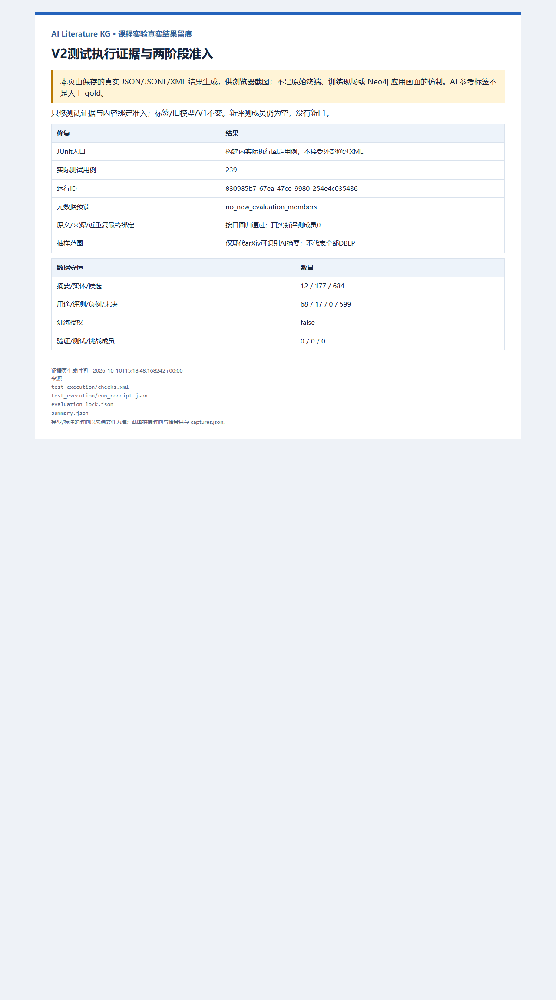

# V2 测试执行证据与两阶段准入修复

本批是独立审核两项P1问题的工程修复与留痕，不是课程最终报告，不是新模型实验。遵循ML数据准入规范，预锁不冒充最终准入，测试通过不冒充语义准确；旧包、旧生成器、旧标签及V1保持原字节。

## 这次具体修好了什么

| 审核发现 | 当前修复 | 仍需区分的边界 |
|---|---|---|
| 一个实际用例、标称205项的伪造JUnit可被旧入口接受 | 新构建入口自行运行冻结的239个测试标识，不再接收外部通过XML；检查实际集合、重复、总数、失败/错误/跳过、退出码及运行记录 | 旧入口仅重放历史，不作为新准入；本地收据不是抵抗可重写全部文件操作者的密码学证明 |
| 新评测身份没有文本SHA也能通过元数据检查 | 分开元数据预锁与实际内容绑定；未知SHA只能处于pending_content_binding，不授权评测 | 准入接口回归不等于已有真实新评测数据 |
| arXiv身份覆盖不等于全部DBLP代表性 | 显式限制为现代arXiv可识别的AI摘要候选，fullDBLPRepresentative=false | 新总体、样本、种子与纳入概率尚未锁定；本批没有抽样 |

当前入口是[新构建器](../scripts/finalize_v2_admission.py)、[受控测试执行器](../scripts/run_v2_admission_checks.py)和[两阶段准入检查](../scripts/course_v2_admission.py)。冻结清单见[239个测试标识与50个源码SHA](../resources/course_v2_admission_test_inventory_v1.json)，完整边界见[准入契约](course_v2_admission_scope_v1.md)。旧生成器与历史审核包没有改写。

## 两阶段状态与调用顺序

1. `prelock(assignments, excluded, aliases, frame)`：只检查身份、组、历史曝光和跨拆分元数据，绑定排除集、别名集和成员集合；不接受正文。存在新评测成员时返回`pending_content_binding`，当前只有train12篇则返回`no_new_evaluation_members`。两者均`evaluationAuthorized=false`。
2. 后续单独授权获取内容后，调用`bind_content(...)`将准确UTF-8摘要字节SHA绑定到不变的成员，重新检查历史与跨拆分文本冲突；已知SHA不允许被更改。
3. 按此内容锁上下文记录来源与近重复复核，再调用`finalize(...)`。必须有非空原文文件、准确SHA、同论文官方arXiv来源URL，以及审核人、时间、理由、真实证据文件SHA和上下文SHA。缺证、未决、被篡改或未锁抽样框均阻断；空评测清单不能完成最终检查。
4. 通过只表示字节与复核档案绑定成立，不自动授权训练/评价。完整参考标注及独立的执行授权仍是下一步条件。

来源与近重复复核是有证据文件的审核判断，不是程序已证明来源真实性、论文存在或语义独立。正向内容绑定测试全部使用明示合成文本，不包装成真实论文。本批没有获取或读取任何新/保留测试正文。

## 实际验证记录

| 验证 | 实际结果 |
|---|---|
| 新增定向测试 | 34项通过；伪造单用例XML、声明/实际数量不符、重复/未知标识、缺SHA、改变内容/证据/预锁上下文等拒绝回归 |
| 新构建入口内部完整V2回归 | 239项通过，0失败/错误/跳过；覆盖7个V2测试文件，不是全仓库测试 |
| 测试运行 | Python3.12.4 / pytest9.0.3；pytest日志163.30秒；执行器收据171.097514秒，两者计时范围不同 |
| 运行ID | `830985b7-67ea-47ce-9980-254e4c035436` |
| 起止UTC | `2026-10-10T15:15:56.595426+00:00` → `2026-10-10T15:18:47.692940+00:00` |
| 基础Python隔离重放 | 只读`python -I -B`实际通过130类文件/契约约束；这些约束不是130项语义正确性测试 |
| 截图 | 已安装Edge154.0.4258.62真实渲染结果页，1280×2300，90,418字节，已目视核对；不是训练现场/Neo4j截图 |

原始运行[JUnit](../kg_datasets/dblp/course_v2_admission_20261010/test_execution/checks.xml)、[日志](../kg_datasets/dblp/course_v2_admission_20261010/test_execution/pytest.log)、[收据](../kg_datasets/dblp/course_v2_admission_20261010/test_execution/run_receipt.json)、[预锁](../kg_datasets/dblp/course_v2_admission_20261010/evaluation_lock.json)、[摘要](../kg_datasets/dblp/course_v2_admission_20261010/summary.json)和[截图收据](../kg_datasets/dblp/course_v2_admission_20261010/captures.json)均随包保留。构建拒绝覆盖旧输出目录。

JUnit SHA-256：`e289faaccbecc8e1c0533f0b58db85912386ff08d8a1ea76660fd2b8dab7c747`。

日志 SHA-256：`00377148f2556a6d016cd62167184355e1cf66b465fc9e7da3d2a209db06ae35`。

截图 SHA-256：`6e62c9ca7ee8d04a5d4352129fac00b7a047e504d5864c78033454c841ee51c1`。

## 数据守恒与真实剩余工作

12篇摘要 / 177实体提及 / 684候选对不变：68用途、17评测、0明确负例、599未决；85正例候选来自11篇论文、29支持组。这些数量不是独立科研事实数。

`references / generation_receipts / reviewed_receipts / relation_ledger / ner_candidates / re_candidates`六个JSONL与父版逐字节一致，全部候选仍`trainingAuthorized=false`。历史排除集、身份别名、覆盖统计、原评测就绪检查及V1保护记录也原样复制。新dev/test/challenge均为0，总体与样本仍未锁。

当前状态：`admission_gates_repaired_missing_negatives_and_new_evaluation_not_training_ready`。本批工程门禁修复结束，但V2模型准备没有完成；下一项实际数据工作是形成符合统一宽口径契约、具有明确证据的负例，以及独立新评测清单和完整参考标签。未知关系不得转成负例。

没有新训练、推理、模型晋级、生产入库或Neo4j在线验收，没有新的Precision/Recall/F1。原模型历史AI参考成绩不变。文件保护检查不代表线上系统本轮健康已验证；AI复核仍不是独立人工金标准。

## 审核与重放

可分享审核包：[v2_admission_audit_20261010.zip](../outputs/v2_admission_audit_20261010.zip)。包含当前manifest列举的文件、完整父版、受控源码快照、真实239项运行记录、外部审核原文、截图及本工作记录；不包含模型权重。新增截图由独立`captures.json`绑定，不改写构建时的manifest。

首次ZIP独立解压以`python -I`重放失败：包内继承的两个`.pyc`在新目录被Python重写，改变manifest绑定的缓存哈希。首次包原样留存`outputs/v2_admission_audit_20261010_first_failed.zip`，不伪称首次通过，也不删除或重签旧源码/缓存。复算确认关闭字节码写入后的`python -I -B`通过130类约束；发布包采用该只读命令，并重新解压验证全部文件哈希。此修复只改重放命令与本工作记录，冻结的50份源码和239项用例不变。

解压后在包根目录执行（只读文件，不需要Torch、Neo4j、GPU或pytest；`-B`必须保留，避免改写历史绑定的缓存）：

```powershell
python -I -B kg_datasets/dblp/course_v2_admission_20261010/source_snapshot/scripts/finalize_v2_admission.py --verify kg_datasets/dblp/course_v2_admission_20261010
```

预期：`status=passed`、`assertionCategories=130`、`actualTestExecutionCases=239`；`evaluationInventoryLocked / finalContentBindingCompleted / semanticAccuracyCertified / liveProductionVerified`均false。

完整239项重新执行则需要项目的训练Python环境及其锁定依赖；离线重放只核对随包的受控执行证据，不冒充再次执行239项。发布后ZIP校验与独立临时目录重放结果另存`outputs/v2_admission_audit_20261010_receipt.json`，避免把自身校验收据写进同一ZIP造成哈希循环。


