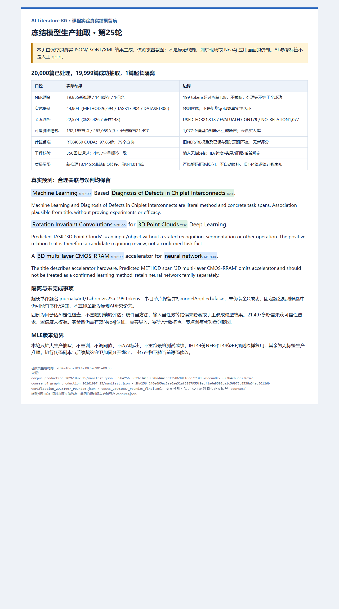

# 第25轮：冻结模型生产抽取与扩展候选图谱包

## 结果及课程口径

对20,000篇题名完成冻结NER→RE生产处理：19,855篇新NER推理、144篇复用旧预测、1篇超长拒绝，成功抽取19,999篇。输出44,904个实体提及、22,574个关系判断；新图谱包有192,185个内容节点、263,059条关系、21,497个候选断言。**这是生产处理和离线候选包完成，不是准确率提升、确定事实认证或Neo4j真实入库成功。**

先做64篇GPU试运行，再扩大至20,000篇；前64篇NER实体和RE标签一致，无训练梯度、阈值调整或新评分。350项最终回归通过（97.57秒，0失败/错误/跳过），另有全量内容核验。349项初次回归和350项后续加固回归分别保存，不冒充同一运行。

按MLE工作流绑定数据、实际执行源码、锁定权重、缓存、分块和失败状态；复用原tokenizer、严格BIO解码、实体对编码、RE前向和候选图谱导出，没有新训练栈。用途仍是[AI文献检索与候选参考文献发现](course_v4_data_expansion_round24.md)：书目提供作者/年份/场馆，候选提及提供方法、任务、数据集关联与题名证据。不能代替阅读全文决定引用，也不虚构CITES或被引次数。

## 实际数量与来源

| 口径 | 数量 | 含义 |
|---|---:|---|
| 处理书目 | 20,000 | 每个canonical论文ID都有结果或明确拒绝 |
| 新NER / 缓存 / 拒绝 | 19,855 / 144 / 1 | 缓存原样复用，拒绝不截断或伪造全O |
| NER成功输出 | 19,999 | 其中259篇没有预测实体，不等于人工确认无实体 |
| METHOD / TASK / DATASET提及 | 26,694 / 17,904 / 306 | 共44,904，是预测数量，不是正确数量 |
| RE候选实体对 | 22,574 | 成功NER预测中的全部METHOD→TASK/DATASET对 |
| 新RE / 缓存RE | 22,426 / 148 | 缓存来自原严格pipeline，不用参考实体替换 |
| USED_FOR / EVALUATED_ON / NO_RELATION | 21,318 / 179 / 1,077 | 负判断不生成正向断言，原判断仍保存 |
| RE标记长度拒绝 | 0 | 每个范围内实体对均有判断 |

144份旧NER实体、148条旧RE判断逻辑内容逐项一致，不新增旧最终测试评分或改写成绩。以前因AI标签未决未评估的题名，本轮只是无标签生产推理，不称独立测试。17快照仍是2000篇AI标注、NER1530篇/RE完整1357篇/1274对；这些是标签资格数，不是本轮预测数或旧模型训练量。

运行成功覆盖19,999/20,000=99.995%，不是召回率/准确率。因此保留`modelAppliedToFullCorpus=false`、`processedModelTitles=20000`、`modelTitles=19999`、`rejectedNERTitles=1`，不将全部处理写成全部成功。

## 新图谱包

新包`kg_datasets/dblp/course_v4_graph_production_20261007_25`，ID为`ai-literature-1020b3aaea22e8e72eb2`；旧18和pilot包保留。只产生独立文件，不自动替换正在运行的应用或数据库。

| 节点 | 数量 | 来源与限制 |
|---|---:|---|
| Publication | 20,000 | DBLP结构化书目，不是神经NER |
| Person | 72,694 | 规范化姓名，未人物主页级消歧 |
| Venue | 3,205 | 原会议/期刊字段 |
| Concept | 29,885 | 类型+casefold字符串合并，不是语义同义消歧 |
| Mention | 44,904 | 原文Unicode跨度、证据、NER权重及来源 |
| Assertion | 21,497 | 21,318用途+179评测候选，未晋级确定事实 |

| 关系 | 数量 | 含义 |
|---|---:|---|
| AUTHORED | 88,762 | 作者→论文，署名顺序保留 |
| PUBLISHED_IN | 19,998 | 论文→场馆，两篇缺失不捏造 |
| MENTIONS / DENOTES | 各44,904 | 论文→提及→字符串概念 |
| SUPPORTED_BY | 21,497 | 断言→题名证据来源，不是结论已证实 |
| HAS_HEAD / HAS_TAIL | 各21,497 | 断言→有方向的头/尾提及 |

Mention/Assertion均为`model_prediction/candidate`，绑定实际run及NER权重；Assertion另绑定RE权重、概率和未校准置信度。1,077个负判断不写正向事实。没有无来源CITES、EDITED、PART_OF或ABOUT，也没有把AI标签改称模型输出。

## 完整流程与核验

1. 核对书目CSV、封存corpus分组清单；复用2000篇匿名ID，其余以论文ID哈希生成稳定ID，验证一一对应。
2. 论文ID/split/groupId仅作追溯，模型输入另存且仅为`sampleId/text/textSha256`，不带标签、实体、主题、划分或AI提示。
3. 核验NER epoch4/RE epoch3选择锁、实际权重及旧预测缓存；完整本地checkpoint加载，冻结梯度、eval/inference_mode，不初始化新分类头。
4. 原tokenizer/128长度契约、无截断、严格BIO解码；预测实体生成全部有方向候选对，原marker编码与类型mask作无label RE前向。
5. 256篇分块、batch8运行，保存79组NER/RE/拒绝文件及逐块processed/elapsed状态；失败保留failed和部分文件，不覆盖重跑。
6. 核对最终输出与分块、完整ID顺序、字面跨度、全部候选对、缓存及输入/权重不变，再导出新图谱包。
7. 核对六类节点/七类边、无悬空端点、断言来自同论文预测提及，每条断言恰有head/tail/supported-by；旧18包与17标签清单不变。
8. 350回归和独立可运行内容核验通过；保存真实结果页面、实际Edge截图，验证页面/副本/图片哈希并查看底部来源。

环境为PyTorch2.8.0+cu126、Transformers4.57.1、RTX4060 Laptop CUDA。脚本记录97.86秒、204.37处理题名/秒：含模型加载、推理和输出拼接，计数含缓存与拒绝，不含进程启动、来源预检和末尾封存。不是纯GPU吞吐或跨机器性能保证。

## 真实问题与可靠性边界

`journals/idt/Tsihrintzis25a`是一条介绍两部能源AI书籍的长书评式题名，199 tokens超过冻结128。保留拒绝原因、token数及书目节点，标`modelApplied=false/modelApplicationStatus=rejected`，不扩大冻结配置或截断后宣称完整抽取。原题名规则候选仍可能包括书评、通知，不统称全部原创AI研究论文。

新推理记录13,145次非法BIO转移，涉及4,014篇；严格解码拒绝孤立/跨类型I、不自动改B。该数不是错误实体数、错误率或总体精度。旧144份缓存无逐篇计数，未知不当0。字面跨度合法也不保证语义正确。

四条[同会话AI定性检查](../annotations/course_v4/production_pilot_cases_20261007_round25.json)包含合理关联和误判：

- ML→芯粒互连缺陷诊断、Diffusion Models→Monte Carlo渲染去噪：题名级关联合理，但不证明实验效果。
- `3D multi-layer CMOS-RRAM`被预测METHOD，题名却讲accelerator硬件，不能认证为学习算法。
- `3D Point Clouds`被预测TASK，却只是输入/对象，未给识别/分割等具体操作；相应断言也需复核。

四例为特意选择，不是随机抽样、人工gold、独立审核或总体precision估计。没有手改“模型预测”、更新权重/阈值或旧test成绩，17标签也没有重训成新模型。`qualityPromotionPassed=false`：扩展运行完成，可靠性晋级未通过/未执行，检索候选仍需读原文。

64篇首次图谱导出因相对`--production`路径与绝对ROOT混用，Path.relative_to抛ValueError；未创建图谱输出/写库，模型未失败。[实际失败原因](../kg_datasets/dblp/course_v4_runs/graph_export_20261007_25_initial_path_failure.json)保留，入口resolve修复并新增相对路径回归，随后pilot和全量导出成功。

全量执行/导出后补强当前守卫：推理前显式拒绝配置/schema与冻结锁不符或缓存属于别的模型；导出验证封存run中实际执行源码副本，而非要求以后工作区源码永不变化。实际执行推理源码仍在run根目录，实际导出器对应[源码归档](../kg_datasets/dblp/course_v4_runs/graph_export_sources_20261007_25/manifest.json)，加固后的当前源码另绑定。没有为加固覆盖或重跑生产预测/最终测试。

## 报告证据与截图

- [当前推理入口](../scripts/infer_course_corpus.py)、[实际执行源码](../kg_datasets/dblp/course_v4_runs/corpus_production_20261007_25/infer_course_corpus.py)、[pilot统计](../kg_datasets/dblp/course_v4_runs/corpus_pilot_20261007_25/summary.json)。
- [生产清单](../kg_datasets/dblp/course_v4_runs/corpus_production_20261007_25/manifest.json)、[统计](../kg_datasets/dblp/course_v4_runs/corpus_production_20261007_25/summary.json)、[状态](../kg_datasets/dblp/course_v4_runs/corpus_production_20261007_25/status.json)、[环境](../kg_datasets/dblp/course_v4_runs/corpus_production_20261007_25/runtime.json)。
- [NER预测](../kg_datasets/dblp/course_v4_runs/corpus_production_20261007_25/ner_predictions.jsonl)、[RE判断](../kg_datasets/dblp/course_v4_runs/corpus_production_20261007_25/relation_predictions.jsonl)、[论文追溯](../kg_datasets/dblp/course_v4_runs/corpus_production_20261007_25/documents.jsonl)、[纯题名输入](../kg_datasets/dblp/course_v4_runs/corpus_production_20261007_25/model_inputs.jsonl)。
- [新图谱清单](../kg_datasets/dblp/course_v4_graph_production_20261007_25/manifest.json)、[节点](../kg_datasets/dblp/course_v4_graph_production_20261007_25/nodes.jsonl)、[边](../kg_datasets/dblp/course_v4_graph_production_20261007_25/edges.jsonl)、[实际导出源码](../kg_datasets/dblp/course_v4_runs/graph_export_sources_20261007_25/course_graph.py)。
- [内容核验](../kg_datasets/dblp/course_v4_runs/verification_20261007_round25.json)、[可运行核验](../annotations/course_v4/check_corpus_20261007_round25.py)、[350最终回归](../kg_datasets/dblp/course_v4_runs/tests_20261007_round25_final.xml)、[349初次回归](../kg_datasets/dblp/course_v4_runs/tests_20261007_round25_all.xml)。
- [图源/副本绑定](evidence/20261007_round25/manifest.json)、[Edge拍摄记录](evidence/20261007_round25/captures.json)、[文档/图片交付核验](../kg_datasets/dblp/course_v4_runs/handoff_verification_20261007_round25.json)。

生产清单SHA：`9021e341e8928ad44edbff58690110cc7f109570eeaa8c73573b4eb3b6776fa7`。

图谱清单SHA：`246e695ec3aa0ae32af5287955f9acf1a6e8502ca1c56078b8538a34eb30126b`。



图注：“20,000篇冻结模型生产处理，19,999成功/1超长隔离，44,904提及/22,574关系判断/21,497候选断言；旧144份NER、148条RE原样复用。非法BIO和语义误判保留，350工程回归通过。未训练、未重评、未真实入库；实际JSON/JSONL/XML的Edge渲染，不是原始终端、独立审核、训练或Neo4j成功画面。”PNG1280×2300、214221字节，已查看正文/来源底部，无裁切。

## 复现与下一步

依赖工作区已有本地权重、选择锁和数据；源码副本用于追溯，不是脱离工作区即可运行的独立安装包。入口拒绝覆盖，重跑使用新路径：

```powershell
& '.\.venv-training\Scripts\python.exe' -B scripts/infer_course_corpus.py --output kg_datasets/dblp/course_v4_runs/NEW_PRODUCTION --device cuda
& '.\.venv-validation\Scripts\python.exe' -B scripts/course_graph.py export --production kg_datasets/dblp/course_v4_runs/NEW_PRODUCTION --bundle kg_datasets/dblp/NEW_GRAPH
& '.\.venv-validation\Scripts\python.exe' -B scripts/course_graph.py verify --bundle kg_datasets/dblp/course_v4_graph_production_20261007_25
```

下一步以新25包真实导入Neo4j、幂等计数、节点图和成功检索/证据回溯截图。默认CLI/app仍是旧18，为历史复现保留，必须显式`--bundle`，不能把旧138篇范围当新包。尚无新的有效凭据，本轮不重试旧密码或重置账户/数据库；此前401/0提交保留，离线节点数不是当前数据库节点数。

本轮另作只读发现接口检查：`127.0.0.1:7474`可达，Neo4j2026.08.0 enterprise，Bolt指向`127.0.0.1:7687`。没有传密码或执行认证/写库，不代表登录已经通过；实际发现结果保存于交付核验。实例可达与有效凭据是不同条件。

有效凭据可用后，以下入口交互询问密码，不将密码写报告：

```powershell
& '.\.venv-validation\Scripts\python.exe' -B scripts/course_graph.py import --bundle kg_datasets/dblp/course_v4_graph_production_20261007_25 --output kg_datasets/dblp/course_v4_runs/NEW_IMPORT_RECEIPT.json --database neo4j --user neo4j
```

候选可用于课程演示，不等于认证研究事实。若训练新模型，先另设未用于开发的新holdout，稀有标签和误判另建版本，不调优已公布最终test。
