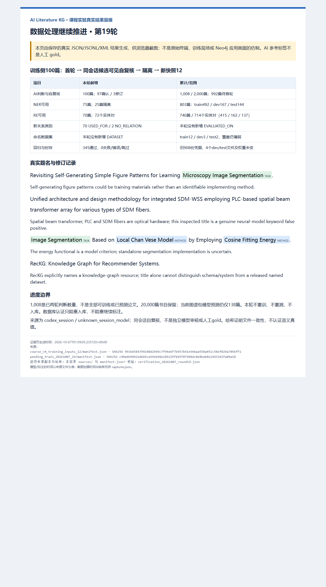

# 第19轮：继续数据处理与AI标注（2026-10-07）

## 本轮完成什么

Neo4j认证失败只影响真实入库，不阻塞本地数据处理。本轮从11快照的匿名待处理队列顺序取100篇训练侧题名，逐篇完成实体、关系首轮AI判断及同会话候选可见自复核，生成新快照12。保留原始DBLP、20,000篇书目、旧快照、旧训练权重与旧最终测试，不覆盖历史材料。

语义判断由当前Codex会话明确写出，脚本仅计算原文跨度、校验、编译及组装，并未调用外部标注模型。来源为`codex_session / unknown_session_model`；不能写成人工标注、独立双盲复核或独立模型审核。

## 数量与口径

| 项目 | 11快照 | 本轮新增 | 12快照 |
|---|---:|---:|---:|
| 已首轮判断且AI自复核的论文 | 908 | 100 | 1,008 |
| 待首轮论文（全部训练侧） | 1,092 | -100 | 992 |
| NER可用论文 | 728 | 75 | 803 |
| RE完整可用论文（含无实体对的完整记录） | 670 | 70 | 740 |
| RE实体对训练/评估记录 | 642 | 72 | 714 |
| 并列共享中心词挑战论文 | 7 | 2 | 9 |

累计已判断train/dev/test为608/200/200篇。NER可用划分492/167/144篇，关系实体对划分415/162/137条；这些是训练输入，不是本轮模型预测或新评估成绩。

新增100篇中97篇复核确认、3篇修订；实体状态未决24篇，关系状态未决29篇。共享中心词并列提及2篇，其中1篇已计入实体未决，因此NER隔离总数25篇。RE可用70篇，其余30篇不输出训练关系；已判断但未决的论文不重新变成待首轮，也不写成空负例。

新增可用NER跨度METHOD91、TASK69、DATASET0；新增可用关系USED_FOR70、NO_RELATION2、EVALUATED_ON0。累计类别覆盖如下：

| 类别 | train | dev | test |
|---|---:|---:|---:|
| METHOD | 581 | 208 | 192 |
| TASK | 438 | 148 | 118 |
| DATASET | 12 | 3 | 2 |
| USED_FOR | 386 | 155 | 132 |
| EVALUATED_ON | 3 | 2 | 1 |
| NO_RELATION | 26 | 5 | 4 |

DATASET/EVALUATED_ON覆盖仍薄弱，不能把命名系统、普通输入材料或评测活动强行归为数据集。`TrainingReady=true`仅说明各类非零支持，不说明数量充足或可靠；12的`trainingStarted=false`表示该新快照未训练，不抹掉历史真实训练。

## 实施流程与证据

1. 验证固定队列、11快照及待处理文件哈希，只取未处理train记录；首轮输入仅匿名ID、题名和文本哈希。
2. 按既有实体与关系契约逐篇判断；未决写原因，共享中心词保留groupMentions，不补造原文缺失词。
3. 复用现有编译器计算Unicode字符跨度、检查实体对覆盖及证据，导入带来源的初次快照。
4. 明确写出每篇自复核确认/修订及原因，绑定初次内容哈希；不以默认循环“批准”全部记录。
5. 合并旧908份凭据及新100份凭据，输出12快照；按任务独立隔离未决、挑战记录。
6. 校验全部NER/RE导出行与凭据一致，队列不重不漏、论文组无跨划分；四份dev/test文件逐字节与11相同，选择锁及实际权重哈希不变。
7. 实跑345项回归，生成真实结果可视化页，实际Edge拍摄并视觉检查，保存来源副本、拍摄时间和哈希。

- [逐篇首轮源码](../annotations/course_v4/pending_train_20261007.py)、[逐篇自复核源码](../annotations/course_v4/pending_train_review_20261007.py)。
- [本轮全部来源和编译/导入产物清单](../kg_datasets/dblp/course_v4_runs/pending_train_20261007_19/manifest.json)。
- [100篇初次决定](../kg_datasets/dblp/course_v4_runs/pending_train_20261007_19/generation_decisions.json)、[100篇复核及3篇完整修订](../kg_datasets/dblp/course_v4_runs/pending_train_20261007_19/review_judgments.json)。
- [12快照进度](../kg_datasets/dblp/course_v4_training_inputs_12/summary.json)、[快照哈希清单](../kg_datasets/dblp/course_v4_training_inputs_12/manifest.json)、[992篇匿名待处理队列](../kg_datasets/dblp/course_v4_training_inputs_12/pending_generation.jsonl)。
- [实际逐项核验记录](../kg_datasets/dblp/course_v4_runs/verification_20261007_round19.json)、[345项回归XML](../kg_datasets/dblp/course_v4_runs/tests_20261007_round19_all.xml)、[可运行核验与证据导出源码](../annotations/course_v4/check_pending_train_20261007.py)。
- [截图图源及来源副本哈希](evidence/20261007_round19/manifest.json)、[实际拍摄记录](evidence/20261007_round19/captures.json)。

12快照manifest SHA-256为`991b6584799240d2969c7f94e6f7b957b41e546aa558a451c58ef029a7056ff1`。哈希用于检测漂移，不证明语义正确或AI身份真实性。

## 检查与修订案例

- `Revisiting Self-Generating Simple Figure Patterns for Learning Microscopy Image Segmentation.`：生成图形可能是训练材料，不足以确认其为执行分割的方法；撤回过于确定的METHOD和USED_FOR，保留明确TASK并隔离未决。
- `Image Segmentation Based on Local Chan Vese Model by Employing Cosine Fitting Energy.`：明确模型用于分割，但能量准则是否独立执行任务不确定，该关系改UNRESOLVED；NER可用而RE整篇隔离。
- `RecKG: Knowledge Graph for Recommender Systems.`：标题无法区分图资源是模式/系统还是发布的数据集，将初次“完整空实体”修订为未决，避免污染全O负例。
- 光学论文中的`spatial beam transformer`是硬件而非神经网络Transformer；逐篇检查后的范围内空实体记录可以进入NER，但不代表已清理全部20,000篇标题筛选误收。原CSV未删除该论文。
- `Model Selection for Offline Reinforcement Learning...`及`Hardware Acceleration of Machine Learning Beyond Linear Algebra.`：学习方法是被选择/被加速对象，不是执行选择/加速的工具，保留两个角色区分NO_RELATION，非“证据缺失当负例”。

## 截图及后续



图注：“训练侧100篇AI标注与同会话自复核：97确认、3修订；累计1,008篇两轮判断，803篇NER可用、714个完整关系对，992篇训练侧待首轮。旧dev/test文件及冻结权重未变。图为真实保存产物的浏览器可视化，不是模型新成绩、人工金标准或Neo4j入库画面。”

下一步继续992篇训练侧队列，沿用逐篇判断、内容绑定、未决隔离、新版本留痕；稀有类别如实报告，不凑标签。本次MLE工作流用于版本与泄漏控制：不改已见测试标签，不利用旧test调参；若用扩展数据训练新模型，另建模型版并在最终评估前锁定未暴露新测试集。

20,000篇书目已准备，但模型预测目前仍仅138篇，未完成全语料模型推理；生产推理扩展也可独立于认证推进。18图谱包不自动包含新增AI标签，伪标签不冒称模型抽取。真实Neo4j导入、节点图与成功检索仍待有效凭据验证，课程整体验收未完成。

历史运行命令（输出已存在，标注/核验/拍摄入口拒绝覆盖；重放应使用新路径并保留输入哈希，回归XML也应另取文件名）：

```powershell
& '.\.venv-validation\Scripts\python.exe' -B annotations/course_v4/pending_train_20261007.py
& '.\.venv-validation\Scripts\python.exe' -B annotations/course_v4/pending_train_review_20261007.py
& '.\.venv-validation\Scripts\python.exe' -m pytest tests -q --junitxml=kg_datasets/dblp/course_v4_runs/tests_20261007_round19_all.xml
& '.\.venv-validation\Scripts\python.exe' -B annotations/course_v4/check_pending_train_20261007.py
& './scripts/capture_course_evidence.ps1' -EvidenceDirectory docs/evidence/20261007_round19
```
