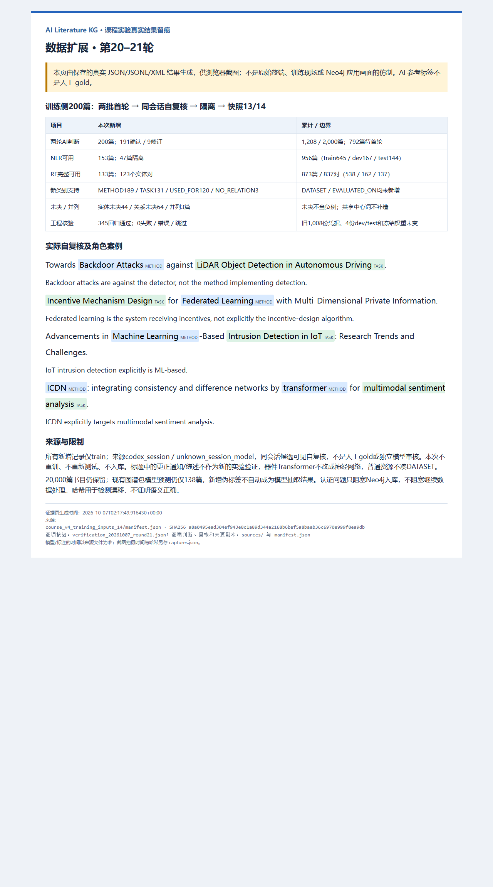

# 第20–21轮：一次推进200篇训练侧数据

## 结果与范围

本次从12快照待处理队列顺序取两批各100篇训练侧题名，完成首轮AI判断和同会话候选可见自复核；生成13、14两个新快照。200篇复核共191确认、9修订，保留初次答案和修订原因。未调用外部标注模型：当前Codex会话逐篇给出语义判断，既有脚本仅编译原文跨度、校验及导出。来源为`codex_session / unknown_session_model`，不是人工gold、独立模型复核或双盲审核。

| 项目 | 原12 | 第一批13 | 第二批14（当前） |
|---|---:|---:|---:|
| 已完成首轮与AI自复核 | 1,008 | 1,108 | 1,208 |
| 训练侧待首轮 | 992 | 892 | 792 |
| NER可用论文 | 803 | 880 | 956 |
| RE完整可用论文 | 740 | 806 | 873 |
| RE实体对 | 714 | 773 | 837 |
| 共享中心词并列挑战论文 | 9 | 11 | 12 |

“已判断论文”“NER可用论文”“RE完整论文”“关系实体对”是不同口径：无范围内实体对但判断完整的论文可计入RE完整论文，不生成关系行。1,208篇已判断不等于全部可训练，更不是已对1,208篇做模型预测。

累计已判断train/dev/test为808/200/200；NER可用645/167/144篇，RE完整577/158/138篇，RE实体对538/162/137条。本次新增NER153篇（第一批77、第二批76），RE完整133篇（66、67），关系123条（59、64）。

新增实体支持METHOD189、TASK131、DATASET0；关系USED_FOR120、NO_RELATION3、EVALUATED_ON0。新增实体未决44篇、关系未决64篇、并列挑战3篇，三篇并列实体状态均完整但按既有政策整篇隔离，因此NER排除47篇、RE排除67篇。未决不凑空负例，不回到待首轮队列；关系未决不阻塞可用NER记录。

| 累计类别支持 | train | dev | test |
|---|---:|---:|---:|
| METHOD | 770 | 208 | 192 |
| TASK | 569 | 148 | 118 |
| DATASET | 12 | 3 | 2 |
| USED_FOR | 506 | 155 | 132 |
| EVALUATED_ON | 3 | 2 | 1 |
| NO_RELATION | 29 | 5 | 4 |

稀有数据集和评估关系没有增加；不是全部类别均改善，也不是新模型效果报告。按MLE工作流只扩大训练侧标签，不改既有dev/test、选择锁或权重，不根据旧最终test调参。新14快照未训练，既有真实模型实验继续保留。

## 完整流程与核验

固定父快照/队列哈希 → 匿名题名首轮逐篇判断 → 既有编译器计算Unicode跨度与证据 → 来源凭据 → 对照初次答案逐篇自复核 → 修订与groupMentions隔离 → 新版本组装 → 全部导出行反查凭据 → 截图与报告。

两批均为未处理train记录，200个ID唯一且不与原1,008份凭据重合。核验父子快照及全部清单内文件、实际来源与复核内容绑定；重新用既有导出器生成六份NER/RE文件到临时目录，逐字节比较一致。组划分无跨split，四份dev/test文件与12逐字节相同；冻结NER/RE实际权重及选择锁哈希不变。固定分组检查不等于穷尽所有语义近重复。

345项实际回归通过，失败/错误/跳过均0；新增标注源码另有完整批次/跨度/实体对/来源/隔离可运行检查。工程校验不证明AI语义标签正确。本次没有训练、模型推理、重新执行最终test或数据库写入。

## 九项修订与实际案例

第一批4项：

- KG补全题名中的`recoding validator`可能只是检查生成的三元组，关系改UNRESOLVED，不强称直接完成KG。
- `Publishing and Using Biographical Linked Data`中的Using未指定计算，完整任务判断改未决。
- `Text Guide`可能选择分类器输入，而非亲自分类；撤回过于确定的USED_FOR。
- 控制混合延迟混沌网络的完整任务包含可辨识网络目标，平面跨度不能同时表示，改未决并隔离。

第二批5项：

- `Complex Network-Based`缩为明确方法族`Complex Network`；泛称图像analysis不足，完整记录改未决。
- `Machine Learning-Based`边界去掉独立连接词后缀Based，保留方法族`Machine Learning`。
- ICDN题名的`consistency and difference networks`共享中心词，改groupMentions，不补造“consistency networks”，不产生整组个体关系；其余ICDN/Transformer关联正常保留，整篇仍隔离。
- RFPruning题名中加速任务与CNN目标重叠，保留已观察关联，但整条完整性改未决。
- 外周动脉疾病management未指定技术操作，撤回完整诊断/管理任务判断，保留未决。

三个新增可用负例来自“后门攻击针对检测器”“ML系统是公平性测试对象”“联邦学习是激励设计对象”；不是无证据时凑NO_RELATION。物理CMOS/高频变压器不标神经Transformer，社会网络扩散和物理迁移扩散不冒称生成扩散。原20,000篇书目仍未全量人工/AI语义清洗，也未删除这些标题规则候选。

更正通知、综述、引言仍保留独立书目身份；更正标题所引用的方法任务只记标题级关联，不当作新实验验证。SemEval/AICity挑战、Wikidata知识库、Iowa Gambling Task行为协议、普通传感器数据不被强行标成已发布评测数据集。初次与修订中的未决实体仍可能只是候选，不进入训练。

## 证据链与截图

- [第一批首轮源码](../annotations/course_v4/pending_train_20261007_round20.py)、[自复核源码](../annotations/course_v4/pending_train_review_20261007_round20.py)、[全部产物清单](../kg_datasets/dblp/course_v4_runs/pending_train_20261007_20/manifest.json)。
- [第二批首轮源码](../annotations/course_v4/pending_train_20261007_round21.py)、[自复核源码](../annotations/course_v4/pending_train_review_20261007_round21.py)、[全部产物清单](../kg_datasets/dblp/course_v4_runs/pending_train_20261007_21/manifest.json)。
- [第一批100条实际复核](../kg_datasets/dblp/course_v4_runs/pending_train_20261007_20/review_judgments.json)、[第二批100条实际复核](../kg_datasets/dblp/course_v4_runs/pending_train_20261007_21/review_judgments.json)。
- [14统计](../kg_datasets/dblp/course_v4_training_inputs_14/summary.json)、[14清单](../kg_datasets/dblp/course_v4_training_inputs_14/manifest.json)、[792篇剩余匿名队列](../kg_datasets/dblp/course_v4_training_inputs_14/pending_generation.jsonl)。
- [逐项核验](../kg_datasets/dblp/course_v4_runs/verification_20261007_round21.json)、[可运行核验源码](../annotations/course_v4/check_pending_train_20261007_round21.py)、[345项回归XML](../kg_datasets/dblp/course_v4_runs/tests_20261007_round20_all.xml)。
- [图源/来源副本哈希](evidence/20261007_round21/manifest.json)、[实际Edge拍摄记录](evidence/20261007_round21/captures.json)。

14快照manifest SHA-256为`a8a0495ead304ef943e8c1a89d344a2168b6bef5a8baab36c6970e999f8ea9db`。来源文件与拍摄时间分别保存UTC，哈希只检测漂移，不认证语义正确或AI身份。旧19截图及全部历史产物保留。



图注：“第20–21轮两批200篇训练侧AI标注与同会话自复核，191确认、9修订。当前1,208篇已判断、956篇NER可用、837个完整关系对，792篇待首轮；旧测试数据及冻结权重未变。图为保存的真实JSON/JSONL/XML产物的实际浏览器可视化，不是原始终端、模型训练现场、人工gold或Neo4j成功界面。”

## 下一步与复现边界

继续792篇训练侧队列，保持本轮规范、来源、未决隔离和新版本留痕，不以补齐稀有数字为目的。若后续训练新模型，另建模型版，并在最终评估前锁定未暴露的新测试集，不在旧test反复宣称最终成绩。

Neo4j认证只阻塞真实入库，不阻塞数据标注或独立生产推理。现有图谱包仍为20,000篇书目、138篇模型预测题名；新增伪标签不会自动进入旧图谱，不冒称模型抽取结果。全语料生产推理、真实入库、节点图与成功检索验收仍未完成。

本轮实际入口为四份逐篇判断/复核源码以及核验源码；原输出已存在，入口拒绝覆盖。重放应另取新路径并保留封存输入哈希；回归重跑使用新XML路径，避免覆盖此次证据：

```powershell
& '.\.venv-validation\Scripts\python.exe' -m pytest tests -q --junitxml=kg_datasets/dblp/course_v4_runs/NEW_REGRESSION.xml
```
