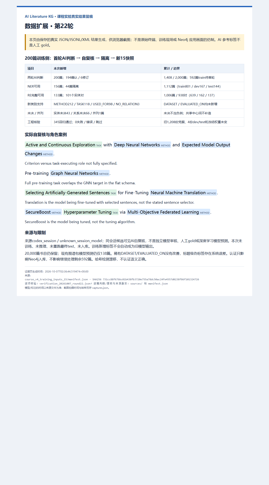

# 第22轮：200篇训练侧题名标注、自复核与版本封存

## 本轮结果

从14快照匿名待处理队列顺序取200篇train题名，当前Codex会话逐篇给出首轮语义判断，并对照候选答案逐篇自复核：194确认、6修订。既有脚本只计算原文跨度、校验、导出，不调用外部标注模型。来源为`codex_session / unknown_session_model`，不是人工gold、独立模型审核或深度学习模型预测。完整判断与修订源码、首次答案均保留，父快照不覆盖。

| 口径 | 原14 | 新15 | 本次新增 |
|---|---:|---:|---:|
| 首轮AI判断及自复核 | 1,208 | 1,408 | 200 |
| train待首轮 | 792 | 592 | -200 |
| NER可用论文 | 956 | 1,112 | 156 |
| RE完整可用论文 | 873 | 1,006 | 133 |
| RE实体对 | 837 | 938 | 101 |
| 共享中心词挑战论文 | 12 | 13 | 1 |

累计已判断train/dev/test为1008/200/200；NER输入801/167/144篇，RE完整710/158/138篇，关系对639/162/137。RE完整论文包括无范围内实体对的完整判断，故不与实体对数量等同；已判断1,408篇不等于1,408篇可训练或已进行模型预测。

新增NER实体支持METHOD212、TASK118、DATASET0；新增RE关系USED_FOR98、NO_RELATION3、EVALUATED_ON0。133篇完整RE中可产生101个关系对，其他完整无对记录不会凑空负例。新增实体未决43篇、关系未决66篇、并列1篇，NER隔离44篇、RE隔离67篇；按任务分别处理，共享中心词groupMentions整篇隔离。隔离记录不是未处理，不重返待首轮队列。

| 累计类别支持 | train | dev | test |
|---|---:|---:|---:|
| METHOD | 982 | 208 | 192 |
| TASK | 687 | 148 | 118 |
| DATASET | 12 | 3 | 2 |
| USED_FOR | 604 | 155 | 132 |
| EVALUATED_ON | 3 | 2 | 1 |
| NO_RELATION | 32 | 5 | 4 |

本批未增加稀有类别；多200篇不是所有类别泛化改善的证据。按MLE工作流只扩大train，保留旧dev/test、选择锁、真实模型权重和历史最终指标；15快照尚未训练。队列2,000篇是首批标注目标，不是课程要求2,000篇人工标签。

## 六项实际修订

1. `Expected Model Output Changes`可能是选择探索输入的采样准则；其到探索的USED_FOR改UNRESOLVED，不把“指导”强等同完整任务执行。
2. `Curriculum`未指定课程学习算法，可能是训练安排/资源；移出确定METHOD，记录实体/关系未决。
3. `Pre-training Graph Neural Networks`含训练操作，完整task跨度与GNN目标重叠；撤回纯方法完整判断，按平面不重叠契约隔离。
4. 语音识别题名中的Transfer Learning可能只是训练识别器；关系改未决，仍保留明确的Language Model Decoding→识别关联。关系未决不阻止这条可用NER。
5. `edited neural networks`去掉状态修饰词edited，确定方法族边界为原文`neural networks`。
6. `Large Language Models are not Fair Evaluators`隐含评估角色，但未给对象/协议或完整task；改未决，不添加不存在的评估对象或伪造负例。

三条可用角色负例分别为：部署到嵌入式系统的DL模型不是部署算法；被微调的翻译模型不是句子选择器；被调参的SecureBoost不是调参器。均有明确角色证据，不因缺少证据就标NO_RELATION。

`Adaptive First- and Second-Order Algorithms`保留groupMentions，不补造缺失中心词。CoADNet展开名是一个联合聚合/分发架构，保留完整复合方法，不拆成两套不存在的名字。公式Transformer是符号变换程序，社会信息diffusion不被冒充生成扩散。VIPriors挑战、普通ECG/视频/多组学数据、Stack Overflow活动不强行凑DATASET。Unicode∞与Layerd/Relu/Distillated原文拼写保留。

## 完整流程与核验

父14及队列哈希绑定 → 匿名200题名逐篇首轮 → 既有编译器生成原文Unicode跨度/证据 → 来源凭据 → 逐篇候选可见自复核 → 完整替换保存修订与理由 → 未决/并列隔离 → 组装新15 → 内容核验 → 实际浏览器截图。

核验1208旧凭据逐条原样、新200仅train且ID唯一；所有父/子/run清单内文件内容哈希一致。用既有导出器在临时目录重生成六份NER/RE文件，逐字节与快照比较，含每个关系端点与证据；592剩余匿名记录精确等于canonical未判断集合，全属train。既有论文组划分校验不等于穷尽所有语义近重复。

四份dev/test文件逐字节不变，冻结NER/RE实际权重与选择锁哈希不变。本次345项实际回归通过，失败/错误/跳过0；新数据另有可运行内容检查。哈希仅检测漂移，工程通过不保证语义正确或独立AI执行。本轮没有训练、模型推理、重跑最终test、数据库写入。

## 证据链与截图

- [逐篇首轮源码](../annotations/course_v4/pending_train_20261007_round22.py)、[逐篇自复核源码](../annotations/course_v4/pending_train_review_20261007_round22.py)、[200条复核判断](../kg_datasets/dblp/course_v4_runs/pending_train_20261007_22/review_judgments.json)、[完整来源清单](../kg_datasets/dblp/course_v4_runs/pending_train_20261007_22/manifest.json)。
- [15统计](../kg_datasets/dblp/course_v4_training_inputs_15/summary.json)、[15清单](../kg_datasets/dblp/course_v4_training_inputs_15/manifest.json)、[592剩余匿名题名](../kg_datasets/dblp/course_v4_training_inputs_15/pending_generation.jsonl)。
- [逐项核验](../kg_datasets/dblp/course_v4_runs/verification_20261007_round22.json)、[核验源码](../annotations/course_v4/check_pending_train_20261007_round22.py)、[实际345回归XML](../kg_datasets/dblp/course_v4_runs/tests_20261007_round22_all.xml)。
- [图源及来源副本哈希](evidence/20261007_round22/manifest.json)、[实际Edge拍摄记录](evidence/20261007_round22/captures.json)。



图注：“第22轮200篇train题名AI标注与同会话自复核，194确认、6修订。15快照累计1,408篇已判断，1,112篇NER可用、938关系对，592篇train待首轮；旧测试文件与权重不变。图由真实保存JSON/JSONL/XML产物实际Edge渲染，不是原始终端、训练现场、独立审核、人工gold或Neo4j成功界面。”实际图片1280×2300、171029字节，已查看全文及底部来源，无裁切；UTC时间、来源与拍摄哈希见记录。15清单SHA-256为`731cc88f67bbc01b438fb3720e755a78dc50ac24fe4557d0238f86f101324726`。全部旧报告/截图保留。

## 下一步及复现边界

继续592篇train队列，采用相同题名政策、来源凭据、未决隔离与新快照，不为增加稀有数字制造标签。后续新模型另建版本，最终成绩须先锁定未暴露新holdout；不能反复使用旧test调参后宣称最终泛化。

仍保留20,000篇书目候选，未进行全量人工/AI语义清洗；当前图谱包预测范围仅138篇，新增AI标签不自动成为模型输出。全语料生产推理、Neo4j真实入库、节点图与成功检索验收尚未完成；认证问题只影响数据库，不是数据处理阻塞。

本轮源码在产物存在时拒绝覆盖。重放须另取新路径并保留输入哈希；回归重跑另存XML，避免改写此次证据：

```powershell
& '.\.venv-validation\Scripts\python.exe' -m pytest tests -q --junitxml=kg_datasets/dblp/course_v4_runs/NEW_REGRESSION.xml
```
