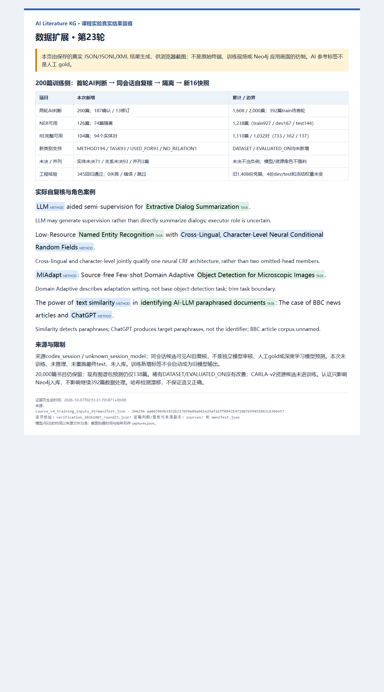

# 第23轮：200篇训练侧AI标注、自复核与完整证据

## 结果和口径

从15快照匿名队列顺序取200篇train题名，当前Codex会话逐篇首轮判断，再对照候选逐篇自复核：187确认、13修订；保留第一次答案和完整替换/修订理由，组装新16快照。既有脚本只编译原文Unicode跨度、校验和导出，不调用外部标注模型。来源`codex_session / unknown_session_model`，属于同会话候选可见AI自复核，不是人工gold、独立模型审核或模型预测。

| 口径 | 原15 | 新16 | 本次新增 |
|---|---:|---:|---:|
| 已首轮并自复核 | 1,408 | 1,608 | 200 |
| train待首轮 | 592 | 392 | -200 |
| NER可用论文 | 1,112 | 1,238 | 126 |
| RE完整可用论文 | 1,006 | 1,110 | 104 |
| RE实体对 | 938 | 1,032 | 94 |
| 并列挑战论文 | 13 | 16 | 3 |

累计已判断train/dev/test为1208/200/200；NER可用927/167/144篇，RE完整814/158/138篇，关系实体对733/162/137。完整无范围内实体对的论文计入RE完整，但不产生关系行，因此论文数和实体对数不同；1,608篇判断不等于全部可训练，更不等于模型预测1,608篇。

新增NER类别支持METHOD194、TASK93、DATASET0；新增RE关系USED_FOR93、NO_RELATION1、EVALUATED_ON0。本次实体未决71篇、关系未决93篇、并列挑战3篇；NER隔离74篇，RE隔离96篇。可用NER但关系未决的记录仅用于NER，不因关系不明就写成负例；隔离是已处理状态，不返回待首轮队列。

| 累计类别支持 | train | dev | test |
|---|---:|---:|---:|
| METHOD | 1176 | 208 | 192 |
| TASK | 780 | 148 | 118 |
| DATASET | 12 | 3 | 2 |
| USED_FOR | 697 | 155 | 132 |
| EVALUATED_ON | 3 | 2 | 1 |
| NO_RELATION | 33 | 5 | 4 |

新增样本没有改善稀有DATASET/EVALUATED_ON，不能宣称全部类别得到优化。按MLE工作流只扩大train、保留旧测试和权重；新16未训练，不修改历史模型成绩或用旧最终test调参。

## 13项实际修订

1. LLM辅助半监督可能只生成监督信息，未确定直接执行对话摘要：关系改UNRESOLVED。
2. `Text-to-image Diffusion-based Synthesis`中方法限定和任务边界交织：保留已观察对抗角色，但完整实体/关系库存改未决，负例不进入训练。
3. `Cross-Lingual, Character-Level Neural Conditional Random Fields`是两个属性联合限定一个架构，不是省略成员并列：改一个完整METHOD，并保留其NER关系，不再整篇挑战隔离。
4. Logic-Aware Curriculum Tuning可能训练推理模型而非直接推理：关系改未决。
5. Encoder-Weight-Only Transfer Learning可能只训练抑郁预测器：关系改未决，无临床效果承诺。
6. IDHEAS未展开，不能只因被integrating就确定它是算法而非框架/资源：实体完整性改未决，独立执行关系改未决；其余明确候选保存。
7. MIAdapt任务去掉适应设定`Domain Adaptive`，保留`Object Detection for Microscopic Images`。
8. 去掉任务中的输入/学习设定`Type Information-Assisted Self-Supervised`，保留`Knowledge Graph Denoising`。
9. Coordinated Autoscaling需保留完整LLM推理工作负载，而该完整任务与模型目标重叠：按既有平面跨度契约隔离，不只靠短语省略对象取得完整判断。
10. targeted drug discovery是宽泛目标，未给明确搜索/生成/预测操作：实体及关系完整性改未决。
11. `SD/SDXL Latent Diffusion Models`共享模型族中心词：改groupMentions，不拆造成员或生成整组个体关系；该篇进入挑战集。
12. transformer-based transfer learning可能只训练IDS-INT：保留命名检测器关联，其训练步骤到检测关系改未决。
13. 删除误作METHOD的`Facebook/Meta`平台名，保留深度学习SEM-ANN方法与泛称analysis未决。

唯一新增可用NO_RELATION来自：text similarity识别AI改写文档，ChatGPT是待识别文档的生成方，不能强称ChatGPT是识别器。BBC新闻文章是未命名语料，不强行凑DATASET。

另外两篇并列为`Transfer and Meta-Learning`和`graph and recurrent neural networks`，不补造原文缺失的学习/网络词，不生成成员关系。CARLA-v2只保留资源类别候选：标题中in并不证明评测于命名数据集，整篇未决未进入NER/RE训练。WMT24共享任务、PubMed数据库、普通气象/多组学/传感器数据不自动变评测数据集。`power transformer`是电力器件，不作神经Transformer。标题疑问/综述只记题名级研究关联，不写成新实验验证。

## 流程与核验

父15和队列哈希绑定 → 200条匿名题名逐篇首轮判断 → 原文Unicode跨度/证据编译 → AI来源凭据 → 200条候选可见自复核 → 完整替换并保存修订 → 按任务隔离未决/整篇并列隔离 → 组装新16 → 重新导出逐字节核对 → 真实浏览器截图。

旧1,408份凭据逐条原样，新200全train且ID唯一，不与旧记录重合。父/子/本轮清单文件全部哈希核验。使用既有导出器在临时目录重生成六份NER/RE文件，逐字节一致，包括关系两端、证据和标签；392待首轮匿名记录精确对应canonical未判断集合，全部train。既有论文组无跨split，但这不保证穷尽所有语义近重复。

四份dev/test文件与15逐字节一致；冻结NER/RE选择锁及实际权重SHA-256不变。345项实际回归通过，失败/错误/跳过0；本轮另有可运行数据内容检查。工程检查和哈希不认证语义正确，也不把同会话审核变独立验证。未训练、未模型推理、未重新执行最终test、未数据库写入。

## 报告证据与截图

- [200条首轮源码](../annotations/course_v4/pending_train_20261007_round23.py)、[逐篇自复核源码](../annotations/course_v4/pending_train_review_20261007_round23.py)、[实际200条复核判断](../kg_datasets/dblp/course_v4_runs/pending_train_20261007_23/review_judgments.json)、[本轮完整来源清单](../kg_datasets/dblp/course_v4_runs/pending_train_20261007_23/manifest.json)。
- [16统计](../kg_datasets/dblp/course_v4_training_inputs_16/summary.json)、[16清单](../kg_datasets/dblp/course_v4_training_inputs_16/manifest.json)、[392剩余题名](../kg_datasets/dblp/course_v4_training_inputs_16/pending_generation.jsonl)。
- [内容核验](../kg_datasets/dblp/course_v4_runs/verification_20261007_round23.json)、[可运行核验源码](../annotations/course_v4/check_pending_train_20261007_round23.py)、[345项回归XML](../kg_datasets/dblp/course_v4_runs/tests_20261007_round23_all.xml)。
- [图源及来源副本哈希](evidence/20261007_round23/manifest.json)、[实际Edge拍摄记录](evidence/20261007_round23/captures.json)。

16清单SHA-256：`aa0d3969b1832b217659a86a661e25afa1ff09431471807659451863c836be57`。UTC时间、来源内容/副本哈希和拍摄记录分开保存；旧快照、判断、权重、报告、截图全部保留。



图注：“第23轮200篇train题名AI首轮与同会话自复核，187确认、13修订。16累计1,608篇已判断、1,238篇NER可用、1,032个关系对，392篇待首轮；稀有类别未增加，旧测试和权重不变。本图由真实JSON/JSONL/XML产物实际Edge渲染，不是原始终端、独立审核、人工gold、模型训练现场或Neo4j成功界面。”实际PNG1280×2300、183957字节，已查看完整正文和底部来源，未裁切。

## 下一步与复现限制

继续392篇训练侧队列，保持同一题名契约、来源记录、未决隔离和版本封存。完成首批标注后，再汇总覆盖/隔离原因，决定是否另建新模型；如训练新版本，应在最终成绩前锁定未暴露新holdout，不反复用旧最终test宣称泛化改善。

20,000篇原书目候选保留，未全量AI语义清洗；现有图谱包预测仍仅138篇。新增伪标签不自动成为旧模型输出，不更新旧图谱候选事实。全语料生产推理、Neo4j真实入库、节点图和成功检索验收尚未完成；数据库认证只阻塞入库，不阻塞标注。

所有本轮入口在产物存在时拒绝覆盖，重放须新路径且保留封存输入哈希；回归重跑也另存XML：

```powershell
& '.\.venv-validation\Scripts\python.exe' -m pytest tests -q --junitxml=kg_datasets/dblp/course_v4_runs/NEW_REGRESSION.xml
```
