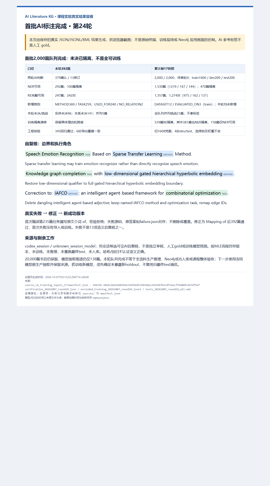

# 第24轮：首批2,000篇AI标注队列完成与数据质量汇总

## 本轮成果与课程口径

完成16快照最后392篇train题名的逐篇首轮判断与候选可见自复核，379确认、13修订，组装并封存新17快照。首批2,000篇全部已判断和自复核，待首轮0；NER可用1,530篇，RE完整可用1,357篇、1,274个实体对。**这代表首批标注队列完成，不代表全部20,000篇已完成模型抽取、标签全正确、全可训练或已成功入库。**

来源为`codex_session / unknown_session_model`，保留逐篇初始答案、修订、理由和输入绑定。属于同会话候选可见AI自复核，不是独立模型审核、人工gold或SciBERT预测。编译/导入脚本只把本会话判断转成原文Unicode跨度、校验凭据、隔离和导出，不执行新的标注模型调用。

领域仍为“人工智能文献检索与候选参考文献发现”。书目元数据回答作者、会议/期刊、年份、题名；题名抽取的METHOD、TASK、DATASET及关系辅助发现同任务不同方法、方法相关研究和有明确评测关联的文献，并回看题名证据及来源。用于减少检索和整理候选文献的时间，不能代替阅读全文确定是否支持论点，也不能由题名推断实验效果或无证据生成CITES。DBLP结构化解析不能冒充实验二、三的深度学习实体/关系抽取；已有冻结模型训练和测试记录另行保留。

## 数量变化

| 口径 | 原16 | 新17 | 本轮新增 |
|---|---:|---:|---:|
| 已首轮并自复核 | 1,608 | 2,000 | 392 |
| train待首轮 | 392 | 0 | -392 |
| NER可用论文 | 1,238 | 1,530 | 292 |
| RE完整可用论文 | 1,110 | 1,357 | 247 |
| RE实体对 | 1,032 | 1,274 | 242 |
| 并列挑战论文 | 16 | 21 | 5 |

| 新17划分 | train | dev | test | 合计 |
|---|---:|---:|---:|---:|
| 已判断/自复核论文 | 1600 | 200 | 200 | 2000 |
| NER可用论文 | 1219 | 167 | 144 | 1530 |
| RE完整可用论文 | 1061 | 158 | 138 | 1357 |
| RE实体对 | 975 | 162 | 137 | 1274 |
| NER可用但无实体 | 30 | 2 | 0 | 32 |
| RE完整但无范围内实体对 | 307 | 45 | 38 | 390 |

全队列NER可用率76.50%，RE完整可用率67.85%。完成但无实体是逐篇检查后的明确空标注，不是未处理文本的默认全O；无关系对论文没有METHOD→TASK/DATASET组合，不产生负例行。967篇RE完整且非空论文产生1,274个对，故论文数和对数不同。导出的零对论文不进入关系分类器训练行。

本轮实体未决96篇、关系未决141篇、并列5篇；按任务资格NER隔离100篇、RE隔离145篇。状态和并列可能重叠，不能直接相加；关系未决也不等于NER不可用。

## 隔离清单与类别覆盖

下表按“并列挑战优先→实体未决→仅关系未决→完整可用”互斥分类，不是用关键词猜测语义原因。

| 隔离/资格原因 | train | dev | test | 合计 |
|---|---:|---:|---:|---:|
| 并列挑战 | 17 | 1 | 3 | 21 |
| 非并列的实体未决 | 364 | 32 | 53 | 449 |
| NER可用、关系未决 | 158 | 9 | 6 | 173 |
| NER与RE完整可用 | 1061 | 158 | 138 | 1357 |

训练侧539篇RE隔离，其中381篇同时NER隔离，158篇仍可进入NER。已导出[逐篇训练隔离清单](../kg_datasets/dblp/course_v4_runs/excluded_training_20261007_round24.jsonl)，包含匿名ID、真实题名/哈希、最终标注内容哈希、论文组、各任务资格、原实体/关系原因和groupMentions。隔离记录已经处理，不返回待首轮队列，不改成NO_RELATION，也不自动删除。后续如补充摘要或扩展并列解析，应新建契约/数据版本，不直接改封存记录。

| 新17类别支持 | train | dev | test | 本轮新增train |
|---|---:|---:|---:|---:|
| METHOD | 1545 | 208 | 192 | 369 |
| TASK | 1039 | 148 | 118 | 259 |
| DATASET | 12 | 3 | 2 | 0 |
| USED_FOR | 937 | 155 | 132 | 240 |
| EVALUATED_ON | 3 | 2 | 1 | 0 |
| NO_RELATION | 35 | 5 | 4 | 2 |

DATASET/EVALUATED_ON覆盖仍非常薄弱；队列处理完没有自动改善稀有类别。summary中的trainingReady只检查每个split非零类别支持，不是“足够样本”“高质量”或“最优”证明。不能为了类别数量把传感器、数据库、知识库、共享任务、普通语料或“a new dataset”泛称改成命名评测集。

## 13项自复核修订及特殊案例

| 批内索引（从0开始） | 修订 |
|---|---|
| 39 | Sparse Transfer Learning可能训练语音情绪识别器，直接执行关系改UNRESOLVED |
| 59 | 未展开UTAUT不能从题名认证为计算方法，实体/关系完整性改未决；教师采用意愿不是计算任务 |
| 66 | Interpretable Network没有具体神经架构身份，保留候选并隔离；tree-FL检测关联保存 |
| 91 | Dynamic Charging Scheme Problem不能凭空解释为调度；去掉泛称Scheme Problem，操作和关系改未决 |
| 107 | 语义相似度可能只给筛选评分而非执行整个系统综述筛选，关系改未决 |
| 150 | 补全`low-dimensional gated hierarchical hyperbolic embedding`方法边界，不能只把限定放notes |
| 159 | Explicit Semantic Guidance可能仅为检测组件，关系与已有未决理由保持一致 |
| 160 | Frequency Spectrum Features Modeling可能只供特征，直接检测关系改未决 |
| 275 | Rényi's Entropy可能只是阈值准则，完整分割执行关系改未决 |
| 281 | 去掉悬空Driven连接词，保留`Symmetry-Informed Multimodal LLM`完整机制限定 |
| 346 | 去掉任务中的Deep方法限定，保留多模态检测/分割和自动驾驶目标 |
| 351 | 删除泛称不完整`intelligent agent-based`方法候选；保留IAFCO与组合优化，实体对ID正确重映射 |
| 370 | 对比表征学习可能训练车辆重识别特征，直接执行关系改未决 |

两条新增明确NO_RELATION：声学对抗逃逸与语音情绪检测、对抗攻击与调制识别，攻击方是对抗角色而不是执行识别；同篇明确识别器用途关系保留。五篇共享中心词并列原文保存为groupMentions，包括监督/无监督深度学习、machine/deep learning、三类Embeddings和generative/discriminative fuzzy RBM learning，不补造成员词和关系，整篇挑战隔离。

保留corrigendum、correction和RETRACTED身份，不当作新的实验验证；物理电力/射频transformer不当神经模型。Uzbek news corpus缺具体发布身份仍为DATASET候选未决；SNOMED CT、EVKG等知识资源不自动作评测集。题名中的综述、疑问、临床/金融应用都只构成研究关联，不证明效果或形成诊疗/投资建议。

## 实际失败、修正与完整流程

首次编译第235篇任务缺介词`of`：原答案`Mapping Pre- and Post-Hurricane Mangrove Canopy Heights`不在题名中，编译器拒绝。只将本轮初始生成目录移到独立失败归档，保留源码、初始392条判断、匿名jobs及failure.json；没有导入凭据或训练。修正为原文`Mapping of Pre- and Post-Hurricane Mangrove Canopy Heights`后在新成功目录编译。本轮核验逐条比较392条首轮答案，除索引235外与失败版本一致。失败与13项语义自复核分开，不删除失败或冒称首次全通过。

完整报告流程：

1. 绑定16清单与最后392条匿名jobs的SHA-256，检查全train、无旧ID重合。
2. 当前会话读取每篇题名，逐篇决定实体、边界、全部范围内实体对、未决和并列，不借助摘要补全。
3. 原文Unicode跨度编译；失败保留→修正原文→新版本编译成功；保存首轮AI来源凭据。
4. 对照首轮候选逐篇同会话自复核，379确认/13修订，保存完整替换和理由。
5. 复核编译、绑定首轮哈希，再导入；按NER/RE分别隔离，组装新17且不覆盖16。
6. 全队列与canonical ID一一覆盖、已有论文组无跨split；旧1608凭据逐条保留，4份dev/test逐字节不变。
7. 用既有导出器在临时目录重生成6份NER/RE文件，逐字节比较；检查头尾实体、关系证据和类别支持。
8. 核验冻结NER/RE选择锁、实际权重与来源清单；345回归全部通过（98.92秒，0失败/错误/跳过）。这是工程检查，不是新的模型成绩或语义准确率。
9. 保存训练隔离清单及内容核验，真实Edge渲染并拍摄截图，核对副本/页面/图片哈希并视觉检查。

按MLE工作流保留旧数据、测试与权重，本轮不训练、不模型推理、不重跑最终test、不数据库写入。新17标签扩展量不能当作旧模型训练量或预测量；哈希只检测漂移，不保证语义正确或独立审核。

## 报告素材与复现

- [首轮392条源码](../annotations/course_v4/pending_train_20261007_round24.py)、[逐篇自复核源码](../annotations/course_v4/pending_train_review_20261007_round24.py)、[实际复核判断](../kg_datasets/dblp/course_v4_runs/pending_train_20261007_24/review_judgments.json)、[本轮清单](../kg_datasets/dblp/course_v4_runs/pending_train_20261007_24/manifest.json)。
- [17统计](../kg_datasets/dblp/course_v4_training_inputs_17/summary.json)、[17清单](../kg_datasets/dblp/course_v4_training_inputs_17/manifest.json)、[空待首轮文件](../kg_datasets/dblp/course_v4_training_inputs_17/pending_generation.jsonl)、[训练隔离记录](../kg_datasets/dblp/course_v4_runs/excluded_training_20261007_round24.jsonl)。
- [失败记录](../kg_datasets/dblp/course_v4_runs/pending_train_20261007_24_initial_compile_failed/failure.json)、[失败初始判断](../kg_datasets/dblp/course_v4_runs/pending_train_20261007_24_initial_compile_failed/generation_decisions.json)、[失败初始源码](../kg_datasets/dblp/course_v4_runs/pending_train_20261007_24_initial_compile_failed/authored_generation.py)。
- [内容核验](../kg_datasets/dblp/course_v4_runs/verification_20261007_round24.json)、[可运行核验源码](../annotations/course_v4/check_pending_train_20261007_round24.py)、[345回归XML](../kg_datasets/dblp/course_v4_runs/tests_20261007_round24_all.xml)。
- [图源/来源副本绑定](evidence/20261007_round24/manifest.json)、[实际Edge拍摄记录](evidence/20261007_round24/captures.json)、[文档与截图交付检查](../kg_datasets/dblp/course_v4_runs/handoff_verification_20261007_round24.json)。

17清单SHA-256：`44b4cded1460294e23d7b6d53303ddace56296fb1c0f2eacff4d009c667df9ef`。源码、凭据、旧快照、模型和历史截图全部保留。入口拒绝覆盖；重放需要修改为新输出路径、仍绑定封存输入，回归另存新XML，不直接覆盖本轮证据。

```powershell
& '.\.venv-validation\Scripts\python.exe' -m pytest tests -q --junitxml=kg_datasets/dblp/course_v4_runs/NEW_REGRESSION.xml
```



图注：“第24轮完成最后392篇train题名首轮与同会话自复核，379确认/13修订。17累计2000篇已判断、1530篇NER可用、1357篇RE完整/1274个对，待首轮0；未决和21篇并列挑战保留。真实跨度失败归档、旧测试与权重不变。由实际JSON/JSONL/XML产物真实Edge渲染，不是原始终端、独立审核、人工gold、训练现场或Neo4j成功界面。”实际PNG1280×2300、194924字节，已查看正文及来源底部，无裁切。

## 下一阶段（不是继续首轮队列）

1. 使用已冻结NER/RE模型对尚未生产抽取的书目做分批无标签推理，绑定论文ID、题名、权重和预测来源，按既有Mention/Assertion契约导出候选事实；生产推理不等于重复评估，不以这些输出改旧test成绩。先小批验证，再扩大，不把AI标签直接替代模型结果。
2. 如确需用17训练新模型，先锁定未暴露、按论文组隔离的新holdout及评估范围，再做train/dev开发；现有test已暴露，不可反复调优后宣称独立泛化改善。稀有类别补采需明确来源/版本，不修改旧dev/test或凑标。
3. Neo4j真实导入、幂等计数、节点图与成功检索截图继续是应用验收项。此前认证失败记录保留，本轮不重试旧凭据、不重置密码/数据库；该问题不阻止生产抽取。当前20,000篇仅书目候选，现有图谱包模型抽取范围仍138篇，课程整体尚未完成。
