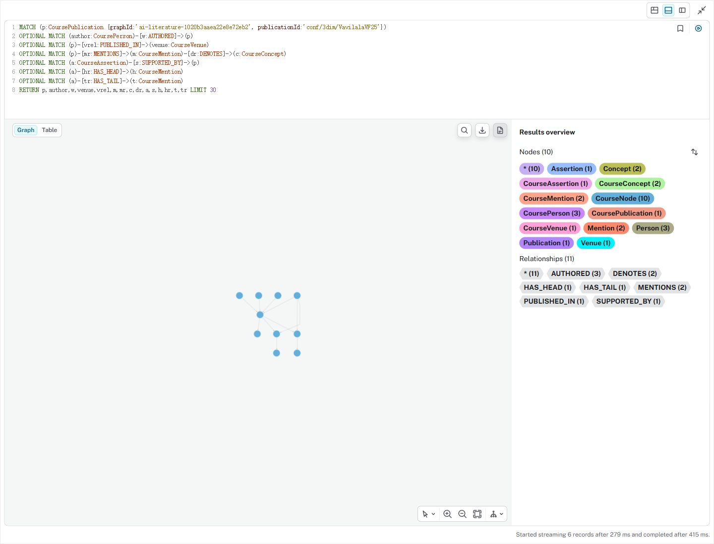
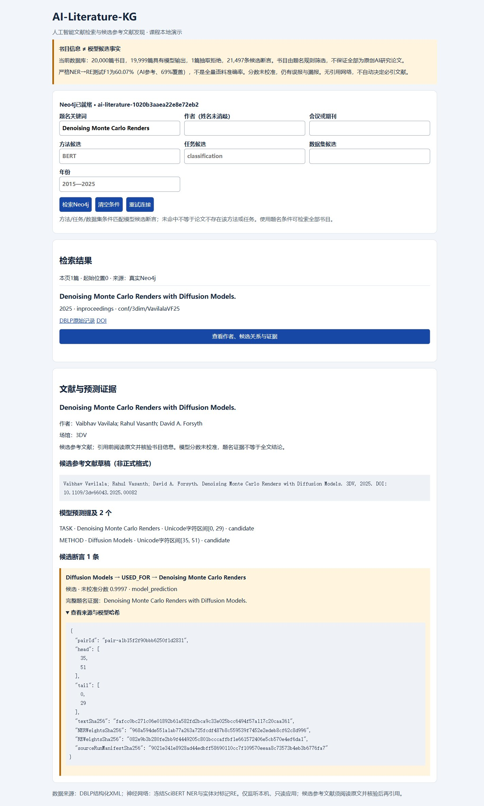

# 第26轮：真实Neo4j入库与文献应用验收

## 当前结论

2026-10-07，用户更新凭据后，`neo4j`业务库认证成功。新25图谱包完成真实入库：20,000篇书目、192,185个内容节点、263,059条关系、21,497个候选断言。另有1个CourseGraph控制节点，不计入内容节点。均为本轮graphId作用域，不冒称整个数据库总数。

首次913个批次，06:19:57–06:21:07 UTC（北京时间14:19:57–14:21:07），约70.85秒，含导入和计数，不是训练时间。再次导入`alreadyImported=true`、0个新增提交批次，六类节点和七类关系计数完全相同。没有删除数据、重置账号/数据库或改写旧包。

本机应用<http://127.0.0.1:8765/>通过18项真实HTTP验收，查询真实Neo4j，没有离线替代结果。350工程回归通过，0失败/错误/跳过。以上是基础入库/应用工程验收，不是模型准确率提升、课程教师验收或全部报告已定稿。

## 实际数量

| 内容节点 | 数量 |
|---|---:|
| Publication | 20,000 |
| Person | 72,694 |
| Venue | 3,205 |
| Concept | 29,885 |
| Mention | 44,904 |
| Assertion | 21,497 |

关系：AUTHORED 88,762；PUBLISHED_IN 19,998；MENTIONS与DENOTES各44,904；SUPPORTED_BY、HAS_HEAD、HAS_TAIL各21,497。共263,059条。论文模型输出19,999篇，超长拒绝1篇；书目节点均保留。

图谱ID：`ai-literature-1020b3aaea22e8e72eb2`。来源是[第25轮生产处理](course_v4_corpus_inference_round25.md)。离线manifest的`liveDatabaseImported=false`是导出时历史状态，不修改封存包；真实入库以本轮回执和数据库completed状态为准。

## 实验四执行流程

1. 原客户端只读执行`RETURN 1 AS connected`，认证通过。密码隐藏输入，只驻留进程/正常浏览器认证上下文，不写入项目配置、报告或验收回执。
2. 核验25封存包，原500行分批MERGE导入CourseNode作用域节点/关系；核对六类节点、七类关系，再置CourseGraph为completed。
3. 新回执重复导入，验证不增量。旧18的401失败、0批次记录原样保留，不改为成功。
4. 只停止已核对身份的旧课程演示服务39388，显式选择25包重启服务。未停止Neo4j实例或无关Python进程。
5. 修复页面写死138篇/140条：health查询真实数据库计数，页面动态显示规模；异常不沿用旧值。超长拒绝、未预测实体和未执行抽取分别提示。共用路径回归通过，无新后端框架。
6. [只读验收脚本](../annotations/course_v4/check_application_20261007_round26.py)检查健康/详情、题名/作者年份/场馆/方法任务联合/数据集候选检索、分页、无结果、超长拒绝、未知文献404、参数400、未知路径404，共18次真实HTTP请求。
7. 真实Neo4j Browser运行[局部图查询](evidence/20261007_round26/graph_query.cypher)：去噪/扩散模型文献，10节点/11关系，含3作者、论文、场馆、2提及、2概念、1候选断言。是局部示例，不是整图规模。
8. 保存原生浏览器截图。工具直接写工作区路径被拒绝，部分动态图调用中断；改取工具返回的原始图片字节保存，没有重画或仿制UI。Browser切为层次布局后保存基础图；放大截图未完成，未冒称另有优化图。

## 发现的问题与边界

首次验收错误地要求Wisconsin候选必有命中，实际为空，保留[失败结果](../kg_datasets/dblp/course_v4_runs/application_acceptance_20261007_26.json)与[当时源码](evidence/20261007_round26/acceptance_initial_source.py)。错误假设是把AI参考实体当作模型已预测候选，不是已证明数据库漏导。

修订验收检查封存预测的检索通路，同时记录Wisconsin无结果。NAIST候选有结果，但题名`Neural Reranking Improves Subjective Quality of Machine Translation: NAIST at WAT2015.`中的NAIST更像组织/系统署名，不能认证为DATASET或实际评估关系。检索成功不等于语义正确，不能通过换案例掩盖缺陷；本轮没有删除/手改预测或重新评分。

冻结NER测试F1仍74.37%，参考实体RE正F1仍99.25%，严格NER→RE正F1仍60.07%；均为部分可判定子集的同会话AI参考一致性，非独立人工gold。没有重训、调参、再执行最终test或可靠性晋级。DATASET/EVALUATED_ON稀少、标题证据有限、作者未消歧、概念仅casefold、非原创条目混入等限制保持。参考文献草稿非正式格式，无真实CITES/被引次数，不能自动决定必引论文。

## 报告截图与证据

- [首次入库回执](../kg_datasets/dblp/course_v4_runs/graph_import_20261007_26.json)、[重复导入回执](../kg_datasets/dblp/course_v4_runs/graph_import_20261007_26_idempotent.json)。
- [18项真实应用验收](../kg_datasets/dblp/course_v4_runs/application_acceptance_20261007_26_final.json)、[图谱模块8项回归](../kg_datasets/dblp/course_v4_runs/tests_graph_20261007_round26.xml)、[全项目350回归](../kg_datasets/dblp/course_v4_runs/tests_20261007_round26_all.xml)。
- [证据清单](evidence/20261007_round26/manifest.json)、[交付核验](../kg_datasets/dblp/course_v4_runs/verification_20261007_round26.json)。源码、回执、实际响应、查询和图片绑定SHA-256；图片保存时间不冒称截图开始时间。



图注：真实Browser局部查询10节点/11关系。基础层次布局，公共CourseNode默认样式使节点同色且图较小，显示美化未完成；不是整库截图或确定事实认证。



图注：实际本机只读应用，规模实时核验；题名命中、作者/场馆/参考文献草稿、实体跨度、候选用途及模型来源哈希。未校准分数不是正确概率。另有[原始检索图](evidence/20261007_round26/02_live_search.png)与[窄视口详情图](evidence/20261007_round26/03_live_detail.png)。

## 运行与后续

当前服务运行于8765。进程退出/系统重启后需重新启动，不承诺持久服务。CLI默认仍历史18，为历史复现保留；务必显式选25包并隐藏交互输入凭据，不同时占用端口：

```powershell
& '.\.venv-validation\Scripts\python.exe' -B scripts/course_graph.py serve --bundle kg_datasets/dblp/course_v4_graph_production_20261007_25 --database neo4j --user neo4j --port 8765
```

验收脚本拒绝覆盖历史输出；原样重放需新文件名。此次不修改原XML、封存模型、标签、25包或旧最终成绩。下一步整理四实验最终报告、图显示美化和限制说明。若提升模型，标签扩展17仍未用于新训练，须先准备未用于开发的新评估集，再另建模型版；课程/模型质量终验尚未通过。
