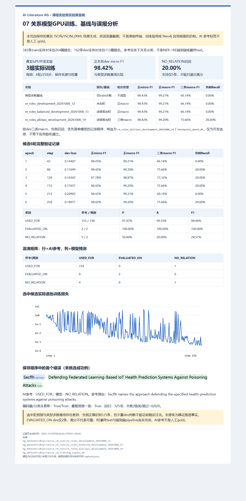

# 关系角色样本补充与开发对照（12–14）

本页保留12–14历史结果；最新15实体对表示对照与RE候选冻结见[新报告](course_v4_relation_entity.md)，不把新权重/成绩回写旧实验。

## 训练前约定

目标是降低把被攻击、被压缩、被验证或受益模型误写为任务执行者的风险，不仅追求高正关系F1。本轮只补固定train侧原待首轮的25篇真实DBLP题名，按上一轮dev错误的角色类别定向选样；没有把dev错误原题名或test加入训练，也没有另造论文。该定向分布有选择偏差，不声称随机抽样或独立盲审。

两轮判断由当前Codex会话AI完成，来源`codex_session / unknown_session_model`；复核看过首轮候选，不是人工gold或独立模型审查。23条确认/2条修订，20篇NER可用、17篇关系可用；关系净增16条USED_FOR和12条NO_RELATION。其余关系/实体未决保留，QuixBugs虽有一个明确评估判断，但同篇仍有未决，不拆出来凑完整训练覆盖。

新导出`course_v4_training_inputs_10`：累计908篇判断（508/200/200），728篇NER输入（417/167/144），关系343/162/0条，来自264/113/0篇有实体对题名。train支持USED_FOR316、EVALUATED_ON3、NO_RELATION24；dev仍155/2/5，test仍无关系标签。原09及NER模型/最终测试保持不变；新增NER输入只保留在数据版中，**不重新训练或测试NER**。

数据、源码、种子和输入特征约束沿用上一轮，SciBERT头尾标记分类头、seed20261006、batch8、lr2e-5、max128、6轮；343条每轮各用一次，43批，末批7条，总258步。12未加权、13仅按train逆频率加权，各从固定基础SciBERT初始化；不从旧模型续训。加权为N/(3n_c)，不使用dev/test计数。按既定dev正关系macro F1选epoch，平分取较早；跨run正macro→负例召回→简单模型。与旧09结果比较时明确训练集已改变、dev仍相同，不称同配置复现。

同时报告正micro/macro、3类支持/混淆矩阵、NO_RELATION P/R/F1和全部错误。相对于旧0/5负例召回，若新候选仍无进展，不能晋级为确证图谱事实。即使有进展，5条负例和2条EVALUATED_ON仍太少，且没有RE test或端到端指标，开发通过也不等于课程或应用验收；暂不根据本次dev分数锁定最终RE测试模型。

PyTorch技能用于复用实际梯度训练与保存重载；MLE工作流用于版本、留出隔离和结果范围；Python测试技能用于角色负例、旧版本保护与数据计数的回归检查。未引入新模型结构、框架或依赖。

### 14开发对照的训练前约定

12/13已实际结束。两组按原正关系macro选择仍为epoch1、负例0/5；13的epoch2/4/6已经出现1/5正确负例，但伴随1条真USED_FOR漏报，正macro约0.9920128略低于多数基线0.9920635，因而未被原规则选择。12的epoch6也有1/5负例，但有4条USED_FOR漏报。这是dev开发证据，不是test。

在运行14**之前**，新增显式`--selection-metric all_class_macro`对照：同一10数据、加权损失、初始化和6轮/258步参数不变，只把选型目标改为USED_FOR/EVALUATED_ON/NO_RELATION三个有支持类别的macro F1，平分仍取较早epoch；不隐藏正micro及逐类代价。包含14的开发比较也按三类macro→负例召回→简单模型。全类平均有意给罕见负类同等权重，可能牺牲正类召回，且5条负例分数不稳定；旧12/13选择记录与权重不改写，不回溯冒称这个规则是首轮预设。不用RE test调参，不宣称全局最优。14结果待实际运行后填写。

## 实际结果与结论

三组均完成真实GPU训练6轮/258步、343条train每轮各见一次；初始及最终保存检查齐全，编码器与分类头实际更新、选中权重和tokenizer重载预测一致。训练状态completed/结果passed只表示工程检查通过，不是关系语义验收。12/13按原正macro选epoch1，所选预测仍与基线相同；14按三类macro选epoch2，出现1条正确负例和1条正例漏报。

| 实验 | 损失 | epoch选型 | 选中轮 | 正micro F1 | 正macro F1 | 三类macro F1 | 负例P / R / F1 |
|---|---|---|---:|---:|---:|---:|---|
| 类型多数基线 | 仅train计数 | 不选型 | — | 98.4326% | 99.2063% | 66.1376% | N/A / 0% / 0% |
| 12 | 未加权 | 正macro | 1 | 98.4326% | 99.2063% | 66.1376% | N/A / 0% / 0% |
| 13 | train逆频率加权 | 正macro | 1 | 98.4326% | 99.2063% | 66.1376% | N/A / 0% / 0% |
| 14 | train逆频率加权 | 三类macro | 2 | 98.4227% | 99.2013% | 75.6580% | 50% / 20% / 28.57% |

相对于基线，14正micro下降约0.0099个百分点，三类macro提高约9.5204个百分点；不能省略正类损失而只宣称提升9.52%。Accuracy仍96.91%（157/162）：一个原负例误报被纠正，同时多一个正例漏报，总错误仍5条。NO_RELATION只有5条参考，20%等于**仅1条**，不能声称已解决角色区分。正micro TP156/预测160/参考157，P97.50%、R99.36%、F1 98.42%。USED_FOR参考155、预测158、TP154；EVALUATED_ON参考2、预测2、TP2；NO_RELATION参考5、预测2、TP1。

14选中混淆矩阵：

| AI参考\模型预测 | USED_FOR | EVALUATED_ON | NO_RELATION |
|---|---:|---:|---:|
| USED_FOR | 154 | 0 | 1 |
| EVALUATED_ON | 0 | 2 | 0 |
| NO_RELATION | 4 | 0 | 1 |

### 14完整逐轮开发记录

| epoch / step | dev未加权loss | 正micro F1 | 三类macro F1 | 负例TP / 参考 |
|---|---:|---:|---:|---:|
| 1 / 43 | 0.144072 | 98.4326% | 66.1376% | 0 / 5 |
| 2 / 86 | 0.116986 | 98.4227% | 75.6580% | 1 / 5 |
| 3 / 129 | 0.165653 | 97.7778% | 73.3238% | 1 / 5 |
| 4 / 172 | 0.176574 | 98.4227% | 75.6580% | 1 / 5 |
| 5 / 215 | 0.209029 | 98.4326% | 66.1376% | 0 / 5 |
| 6 / 258 | 0.189766 | 98.4227% | 75.6580% | 1 / 5 |

2/4/6三类macro相同，按既定早轮规则选择2，不挑训练结束的最后轮。13与14的逐步梯度日志和各轮dev数值完全一致；改变的是选择目标和保存的最佳权重，不是数据、梯度算法或训练性能神奇提高。该关系已实际核对，不是多seed稳定性证明。12/13/14整流程耗时81.36/64.29/81.58秒，含冷启动、文件保存与coverage开销，不用于方法速度比较。

### 正确角色信号与全部剩余错误

唯一纠正负例：`sample-1412781f2a4ef8311aeb`，题名“Optimal Scheduling Algorithms for LLM Inference: Theory and Practice.”。LLM→Scheduling现预测NO_RELATION，与AI参考一致：LLM推理是被调度对象，不是调度算法。这个题名仅在固定dev中，**没有回灌训练**。

| sampleId后缀 | 14剩余错误 | 错误性质 |
|---|---|---|
| 4756f501a75a55ebff3f | Secflh→Defending Federated Learning-Based IoT Health Prediction Systems Against Poisoning Attacks：USED_FOR被预测NO_RELATION | 新增漏报；真正防御算法不能因为题名含“攻击”就被当成攻击对象。 |
| c0fd77afb68c65c839e8 | Neural Network→Hiding CNN Parameters：NO_RELATION被预测USED_FOR | 受保护模型仍被误读为隐藏参数工具。 |
| 710c48d6461a108d253d | Adversarial Training→Robustness Evaluation of Text Classification Models：NO_RELATION被预测USED_FOR | 下游应用仍被误读为直接评估工具。 |
| ad366be658bf5d281e54 | Deep Learning-Based Wind Speed Prediction→Cross-Dataset Data Augmentation：NO_RELATION被预测USED_FOR | 受益者仍被误读为数据增强工具。 |
| 52e04b4842fc31291bdc | Multimodal Large Language Models→Mitigating Multi-Image Hallucinations：NO_RELATION被预测USED_FOR | 幻觉被缓解的模型仍被当成缓解工具。 |

首例Secflh负类概率0.6289063，原隐藏参数误报的正类概率由10的0.9837775变为14的0.6304803，但预测仍错；未经校准概率变化不等于正确性。全部5条错误保存，不为了成绩修改dev参考标签。仅有题名、伪标签相关错误、强类型先验和稀有支持仍限制解释；不能证明唯一根因。

## 截图与验收范围



图注：10数据快照343train/162dev参考实体对上，三组SciBERT分别真实GPU训练6轮/258步；14采用三类macro选epoch2，负例正确1/5，另1条真USED_FOR被漏报，正关系F1 98.42%、三类macro75.66%。仍非RE最终测试、NER→RE端到端或人工gold成绩。图是保存的真实结果的Edge浏览器截图，非原始终端或Neo4j界面；旧11张图保留，累计12张。

截图导出器的一处旧数据计数常量会把新343/264错误写成315/247；新增实际新版本回归先失败，再将计数、训练轮数/步数及首个错误说明改为从绑定输入/运行读取。还验证选择指标与封存config一致，用同一`selection_score`重算最佳轮；不沿用旧正macro来误选14。历史已封存截图内容和哈希不改。

325项全项目回归通过，失败/错误/跳过均0；[pytest XML](../kg_datasets/dblp/course_v4_runs/tests_20261006_round14_final.xml)记录63.509秒。关系入口同源码的9项单元与14实际训练合并覆盖290/307条语句=94.46%，17条未覆盖，未把旧12/13行号的coverage合入新源码；见 [coverage记录](../kg_datasets/dblp/course_v4_runs/coverage_re_roles_combined_20261006_14.json)。覆盖率不是语义准确率、全部异常分支证明或课程验收。

完整运行：[12清单](../kg_datasets/dblp/course_v4_runs/re_roles_development_20261006_12/manifest.json)、[13清单](../kg_datasets/dblp/course_v4_runs/re_roles_balanced_development_20261006_13/manifest.json)、[14清单](../kg_datasets/dblp/course_v4_runs/re_roles_allclass_development_20261006_14/manifest.json)/[指标](../kg_datasets/dblp/course_v4_runs/re_roles_allclass_development_20261006_14/development_result.json)/[逐轮](../kg_datasets/dblp/course_v4_runs/re_roles_allclass_development_20261006_14/epochs.json)/[全部错误](../kg_datasets/dblp/course_v4_runs/re_roles_allclass_development_20261006_14/dev_errors.jsonl)。14选中权重SHA-256为`f2a595205f0724f9895c9417204873e41bb2ec87a0a5e1fabcc1ca837d497c2e`；旧正macro最佳权重不替换成新选择。每个manifest绑定当时归档源码及数据，当前源码新增selection_metric，复现旧版须采用其归档，而非声称旧源码等于当前文件。

图8对应 [源页/来源副本清单](evidence/20261006_round14/manifest.json)、[实际Edge拍摄记录](evidence/20261006_round14/captures.json)及[图注](evidence/20261006_round14/report_figures.md)。生成清单的pending不改写，captures.completed才是实际拍摄完成状态。

[本轮全链路核验](../kg_datasets/dblp/course_v4_runs/verification_20261006_round14.json)：165个运行目录1078个封存输出、10个导出版本88个文件、21个原始输入及累计12张图哈希通过；dev/test输入与09逐字节一致、旧883份凭据保留、冻结NER权重与最终测试清单不变。新图包40个页面/来源文件封存。

```powershell
& '.\.venv-validation\Scripts\python.exe' -B scripts/export_course_evidence.py --dataset kg_datasets/dblp/course_v4_weak --snapshot kg_datasets/dblp/course_v4_training_inputs_10 --relation-development kg_datasets/dblp/course_v4_runs/re_roles_development_20261006_12 kg_datasets/dblp/course_v4_runs/re_roles_balanced_development_20261006_13 kg_datasets/dblp/course_v4_runs/re_roles_allclass_development_20261006_14 --tests kg_datasets/dblp/course_v4_runs/tests_20261006_round14_final.xml --output docs/evidence/NEW_ROLE_EVIDENCE
& './scripts/capture_course_evidence.ps1' -EvidenceDirectory docs/evidence/NEW_ROLE_EVIDENCE
```

最终RE test仍无标签且未推理；端到端及Neo4j应用未完成。14仅为角色开发候选，未晋级为确证图谱事实。下一步优先处理仍未决的训练侧角色/稀有评估类，若扩展标题以外的摘要须另建来源及文本版本；不能把空候选、一般on/for、未决或采集伪造当新评估支持。不重新训练已见test的NER，也不反复查询RE test来调参。

## 留痕与复现

- [明确选样脚本](../annotations/course_v4/relation_priority002_jobs.py)、[25篇匿名输入](../kg_datasets/dblp/course_v4_runs/relation_priority002_jobs/jobs.jsonl)及[选样清单](../kg_datasets/dblp/course_v4_runs/relation_priority002_jobs/manifest.json)。
- [AI首轮](../annotations/course_v4/relation_priority002_generation_decisions.json)、[25条候选可见自复核](../annotations/course_v4/relation_priority002_review_judgments.json)，原判断不覆盖。
- [累计10数据清单](../kg_datasets/dblp/course_v4_training_inputs_10/manifest.json)、[数据统计](../kg_datasets/dblp/course_v4_training_inputs_10/summary.json)、[累计凭据](../kg_datasets/dblp/course_v4_training_inputs_10/receipts.jsonl)。

```powershell
# 旧目录不可覆盖；加权对照只添加 --balanced-loss。
& '.\.venv-training\Scripts\python.exe' -B scripts/train_course_relation.py --dataset kg_datasets/dblp/course_v4_weak --snapshot kg_datasets/dblp/course_v4_training_inputs_10 --model kg_datasets/models/scibert_24f92d32 --output kg_datasets/dblp/course_v4_runs/NEW_ROLE_RE_DEV --device cuda
& '.\.venv-validation\Scripts\python.exe' -B -m pytest tests/test_course_relation_priority.py -q
```
