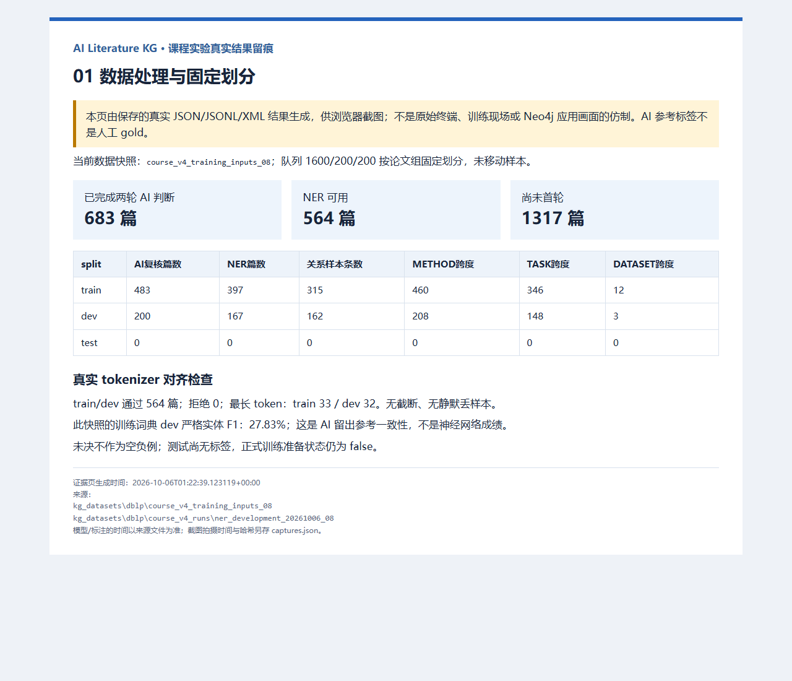
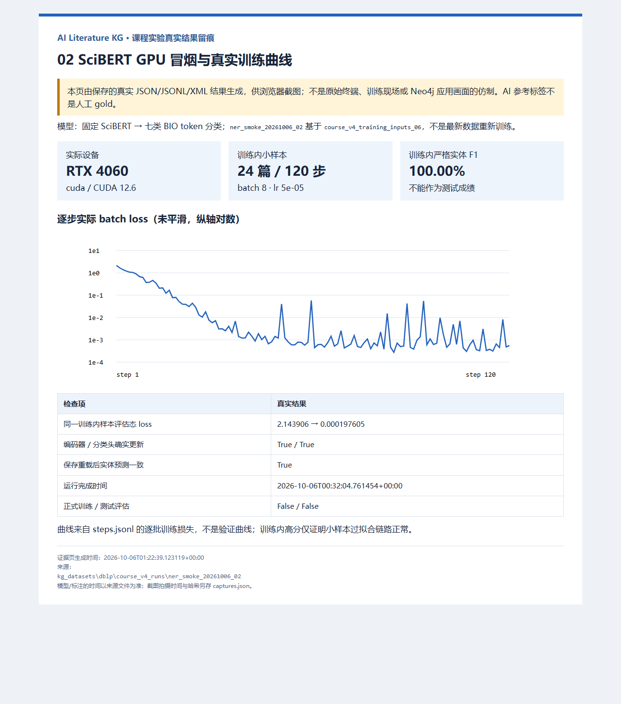
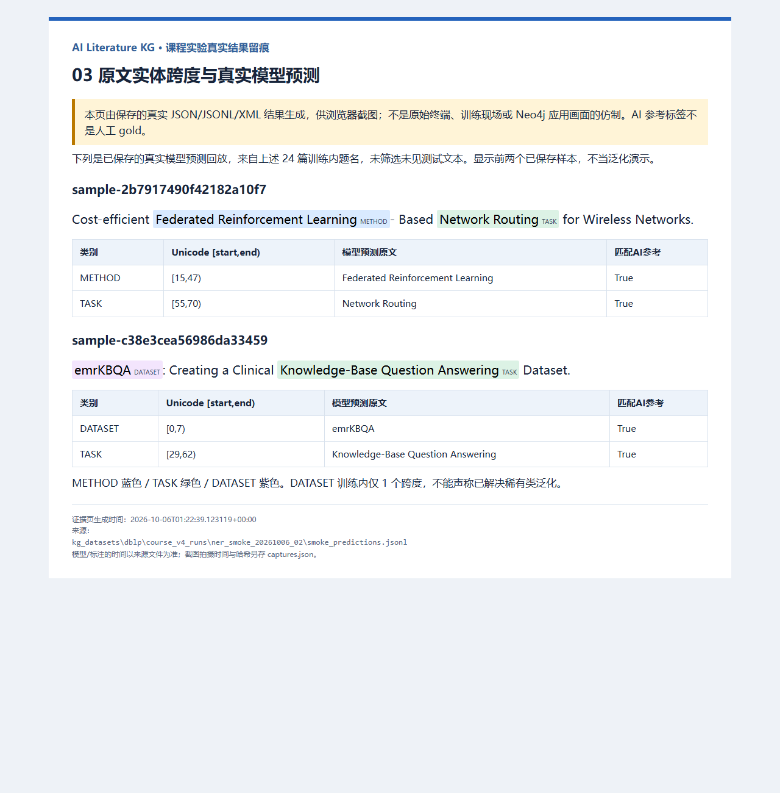
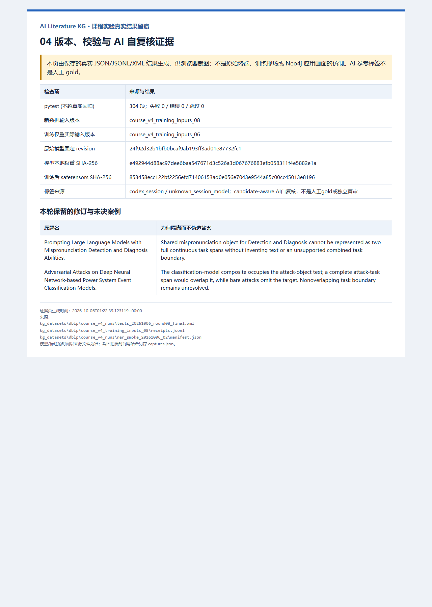
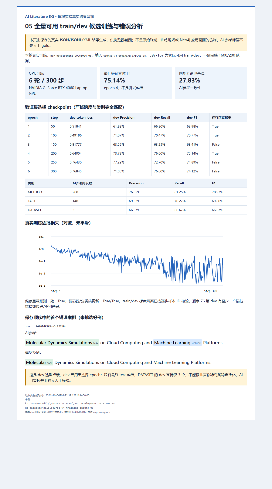

# 报告截图索引

本包为真实结果文件的离线可视化，不是终端或 Neo4j 原始界面。截图完成情况以 captures.json 为准。

## 01 数据处理与固定划分

页面：[01_data.html](01_data.html)。插图必须保留页内阶段、输入版本和局限说明；不能把训练内 100% 当测试成绩。

## 02 SciBERT GPU 冒烟与真实训练曲线

页面：[02_training.html](02_training.html)。插图必须保留页内阶段、输入版本和局限说明；不能把训练内 100% 当测试成绩。

## 03 原文实体跨度与真实模型预测

页面：[03_predictions.html](03_predictions.html)。插图必须保留页内阶段、输入版本和局限说明；不能把训练内 100% 当测试成绩。

## 04 版本、校验与 AI 自复核证据

页面：[04_traceability.html](04_traceability.html)。插图必须保留页内阶段、输入版本和局限说明；不能把训练内 100% 当测试成绩。

## 05 全量可用 train/dev 候选训练与错误分析

页面：[05_development.html](05_development.html)。插图必须保留页内阶段、输入版本和局限说明；不能把训练内 100% 当测试成绩。

最终 NER/test、关系模型、Neo4j 导入和检索应用尚未完成，未生成这些阶段的成功截图。原始来源文件副本见 sources/；页面与来源哈希见 manifest.json，图片与拍摄方式见 captures.json。
